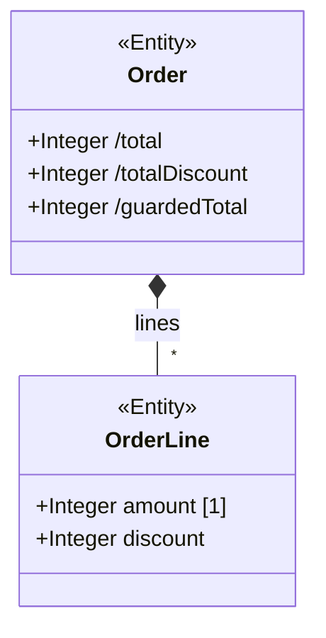

## Intent

A derived attribute that adds up a field over a collection must behave well when some items have no value in that field, or when the collection is empty. Make the null handling explicit in the expression.

## Practice

### Choose the guard by the field's cardinality

This is a convention on top of the platform's collection functions. The platform (see [model development, collection functions](../../agent-docs/model/model-development.md)) provides `!filter`, `!isDefined()`, `!count()`, `!sum`, `!avg`, `!min`, `!max` and the ternary `cond ? a : b`. It does not document how an undefined selector value or an empty collection is treated by `!sum`, so the practice does not rely on either.

- **Required field**: sum it directly, `self.lines!sum(l | l.amount)`.
- **Optional field**: filter first, `self.lines!filter(l | l.discount!isDefined())!sum(l | l.discount)`.
- **Possibly empty collection**: guard with the ternary, `self.lines!count() > 0 ? self.lines!sum(l | l.amount) : 0`. Both branches must have the same kind (the platform requires the same kind for then and else).

### Know the limits of the aggregates

`!sum` accepts integer and decimal selectors only; other types fail with `Invalid expression for aggregation`. `!avg`, `!min` and `!max` take the same selector form, so the same filter-first shape applies to them. Keep each lambda to one iteration variable: lambdas do not nest and cannot see `self`.

Only `!count()` is wrapped to return 0 on an empty collection (`COALESCE(..., 0)`); `!sum`, `!avg`, `!min` and `!max` are plain aggregates over a sub-select, so on an empty collection they most likely return no value (undefined) without an error (*verify* at runtime). Check `!count()` (or `!isDefined()`) before using the result in a label. Integer collections do not support `!avg` (only sum, min and max).

### Put the aggregate where it is read

Declare the expression as a derived member of the entity (or of a transfer object) and let pages and operations read it. See [[derived-attribute-flattening]] for derived members and [[integer-boolean-for-aggregation]] for counting flags with `!sum`.

## Rationale

- The null handling is visible in the model expression, not hidden in a service.
- Filtering by `!isDefined()` is composable: any further collection function can follow it.
- Cost: verbose compared to a null-coalescing aggregate, and easy to forget on optional fields.

## Example

### Order total with optional discounts

A neutral Order owns a composition collection of OrderLine items. OrderLine has a required `amount` and an optional `discount`. Order carries three derived members: `total` sums `amount` directly; `totalDiscount` filters on `discount!isDefined()` before summing; `guardedTotal` returns 0 when there are no lines.

The original projects used the same three forms. One summed a required saving-potential field directly and used the filter form for an optional "actual saving" that is empty until entered. Another guarded its point and total sums with the count ternary, and counted completed rows with filter plus `!count()`.

## When to avoid

- The field is required everywhere: the plain sum is enough.
- The aggregated value is needed in a stored column: use a stored value maintained by an operation instead, see [[aggregated-stored-field]].

## Related

- [[derived-attribute-flattening]] — derived members that hold the aggregate
- [[derived-relation-navigation]] — navigating to the collection being aggregated
- [[integer-boolean-for-aggregation]] — summing 0/1 flags
- [[aggregated-stored-field]] — stored alternative to a derived aggregate
