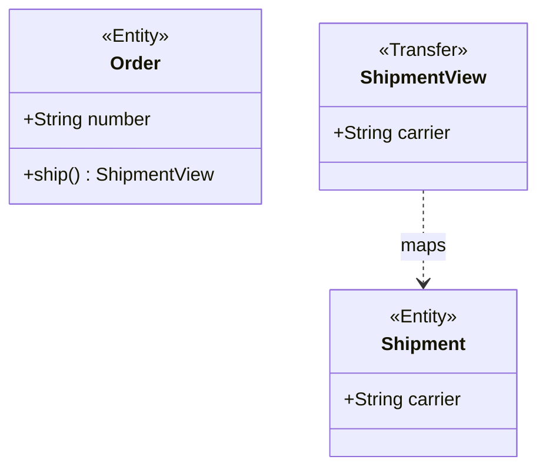

## Intent

An operation returns an instance the user will probably want to look at and change right away (for example a newly chosen or created record). Declare on the output parameter that clients may update and delete the returned instances, so the result is not read-only.

## Practice

### Allow CRUD on the output parameter

The ESM operation package gives an operation an optional `output` parameter that targets a transfer object type. When `output` is set, the operation's CRUD settings become available: `updateable` (external clients can modify the returned instances) and `deleteable` (external clients can delete them). See [operation reference, Output CRUD Settings](../../agent-docs/model/esm_metamodel/operation.md). Both default to false.

- Return a **mapped** transfer object (one that maps an entity) so there are instances to update or delete. For an unmapped result see [[unmapped-transfer-dto]].
- Set only the flags the workflow needs. An output that is only displayed keeps both false.
- The output cardinality is `0..1`, `1..1` or `0..*`; a single-instance output suits the "act on the result" workflow best.

### Choose where the user lands after the call

The agent-docs describe `postCallAccessNavigation` on the UI OperationForm: an access of the same type as the operation output to navigate to after a successful call. Use it when the result should open on a page. See [[operation-return-type-navigation]].

### Scope of what the platform documents

The old project notes talk of a `behaviours` list (REFRESH, UPDATE, DELETE) on the output and a generated OPERATION_OUTPUT_UPDATE page. The agent-docs do not document either. They document the `updateable` / `deleteable` flags and the generated result display ("result display if output is defined"). Treat the page type name as a project observation, not a platform contract. In the operation reference, REFRESH, UPDATE_INSTANCE and DELETE_INSTANCE are operation *behaviour types* of generated operations, a different concept.

## Rationale

- The permission is declared in the model next to the operation, so the generated API and UI agree on what may be done with the result.
- No extra navigation step between producing and managing the instance.
- Limit: the flags are fixed per operation and are not conditional on state. Guard sensitive updates with access rules or interceptors on the transfer object.

## Example

A neutral Order entity has an instance operation `ship`. It returns a `ShipmentView`, a transfer object mapping the Shipment entity (attribute `carrier`). The `output` parameter of `ship` has `updateable` and `deleteable` set, so after shipping, the user can correct or remove the created shipment from the result. The original project had a planet operation returning a creature with all three actions; names here are neutral stand-ins.

## When to avoid

- The result is purely informational: keep the output read-only.
- The output is an unmapped transfer object: there is nothing to update or delete.
- Deleting or changing the result needs state-dependent rules: express them in access or interceptors, not by the flags alone.

## Related

- [[unmapped-transfer-dto]] — outputs that carry no entity
- [[mapped-operation-delegation]] — operations bound to entity operations
- [[operation-return-type-navigation]] — where the user goes after the call

## Structure diagram

<!-- mermaid:generated fragment=operation-output-with-behaviors cli=1.1.0.20261108_202643_d9769d90_develop -->

<!-- /mermaid:generated -->
