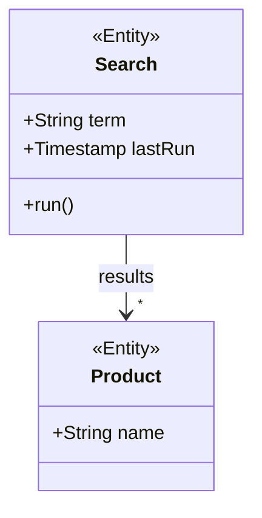

## Intent

An expensive or user-triggered computation (a search, a report run) should leave its result behind. The entity keeps the result in a stored relation plus the time of the last run, so pages can show the result later without computing it again.

## Practice

### Clear, compute, store, stamp

The entity has a stored collection relation for the results and a Timestamp attribute for the last run. A stateful instance operation with a JCL body ([Operation script language](../../agent-docs/model/jcl-operation-scripts.md)) does four things in order:

1. Clear: remove the previous results from the relation with `-=`.
2. Compute: add the new results with `+=`.
3. Stamp: assign the current timestamp using the temporal function `Timestamp!now()` (a `SYSTEM` environment value, see [model development, JQL reference](../../agent-docs/model/model-development.md)).
4. Return nothing, or return the entity or a view; pages read the stored relation.

Reference sets are changed only with `+=` and `-=` in scripts; a bare navigation as a statement is an error.

### The operation must be stateful

The operation writes, so it must be modelled `stateful = true`; a write in a stateless operation throws `IllegalStateException` at runtime (see [operation reference](../../agent-docs/model/esm_metamodel/operation.md), statefulness section).

### This is a convention

The platform has no result-cache concept and no invalidation: nothing refreshes the stored results when the source data changes. Re-running the operation is the only refresh, and the timestamp tells users how old the result is.

## Rationale

- Results are ordinary stored data, so pages can list, sort and page them like any relation.
- The timestamp gives users and auditors the age of the result.
- Costs: results can be stale; clear and refill of large result sets is expensive; the results consume storage.

## Example

A neutral Search entity has a `term`, a stored relation `results` to Product (0..*) and a `lastRun` Timestamp. Its `run` operation clears `results`, adds the products matching the term and sets `lastRun` to now. The original project did the same with a search entity that combined users from several navigation paths, and with a report definition whose run stored result rows together with an execution time and a download link.

## When to avoid

- The result is cheap and always current: use a derived relation ([[derived-relation-navigation]]) instead of storing it.
- The result must follow source changes live.
- Result sets are large and rarely read again.

## Related

- [[mapped-operation-delegation]] — mapped operations that start the run
- [[derived-relation-navigation]] — computed instead of cached
- [[operation-output-with-behaviors]] — returning the result of an operation

## Structure diagram

