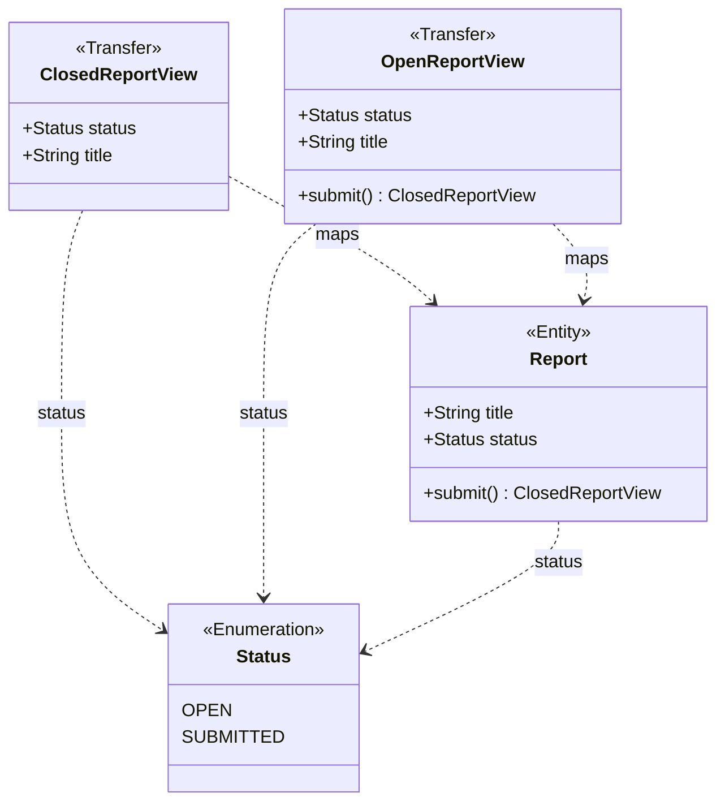

## Intent

A state change moves an instance out of the list the user is looking at and into another one (an open report becomes a closed report). Let the operation return the transfer object type of the destination, and point the UI's post-call navigation at the access that shows that type.

## Practice

### Return the destination's transfer type

The entity operation changes the state and returns `this`. The operation's `output` parameter targets a transfer object type other than the caller's one (for example the closed-report view instead of the open-report view). A mapped operation on the source view binds to the entity operation and declares the destination type as its output. Operation scripts are described in [Operation script language](../../agent-docs/model/jcl-operation-scripts.md); the operation must be `stateful` because it writes.

### Navigate through the operation form's post-call access

What the platform documents (see [UI behaviour rules, OperationForm](../../agent-docs/model/esm_metamodel/ui-behaviour.md)): the UI OperationForm has a `postCallAccessNavigation` attribute, "navigate to access of same type of operation output instance after successful call"; its candidates are accesses whose target type matches the operation output type. So the output type decides which accesses can be chosen, and the navigation is a model setting on the operation form, not an implicit effect of any differing return type. Do not assume the UI redirects by itself: check the generated page, and see [[operation-output-with-behaviors]] for the result display.

### When the destination is not a fixed access

If the target depends on runtime data, return a redirect transfer object (target actor, access, id) and let a frontend `OperationFlowManager` hook turn it into navigation. The hook interface is in [action hooks](../../agent-docs/frontend/hooks/action-hooks.md). The workflow-engine project used this, with redirect objects mapped from its context entities.

## Rationale

- The routing rule stays declarative in the model: the output type names the destination.
- No client routing code for the common case.
- Limits: it fits single-instance returns; the destination must be an access of the output's type; the old list refreshes without the moved instance only when the partitioning follows the state ([[state-based-transfer-partitioning]]).

## Example

A neutral Report entity has a `status` (Open, Submitted). `OpenReportView` and `ClosedReportView` both map Report. The `submit` operation sets the status to Submitted and returns `this`; on the open view it is a mapped operation whose output is `ClosedReportView`. After a successful call the form navigates to the closed-reports access, where the instance now appears. In the original project the same shape routed partners from "open" to "closed" reports.

## When to avoid

- The state change does not move the instance between views: return nothing or the same view type.
- The operation returns a collection or non-entity data.
- The destination cannot be an access of the returned type: use the redirect-object approach.

## Related

- [[state-based-transfer-partitioning]] — the views the instance moves between
- [[mapped-operation-delegation]] — mapped operations bound to entity operations
- [[enum-state-machine]] — the status being changed
- [[operation-output-with-behaviors]] — result handling on the output parameter

## Structure diagram

