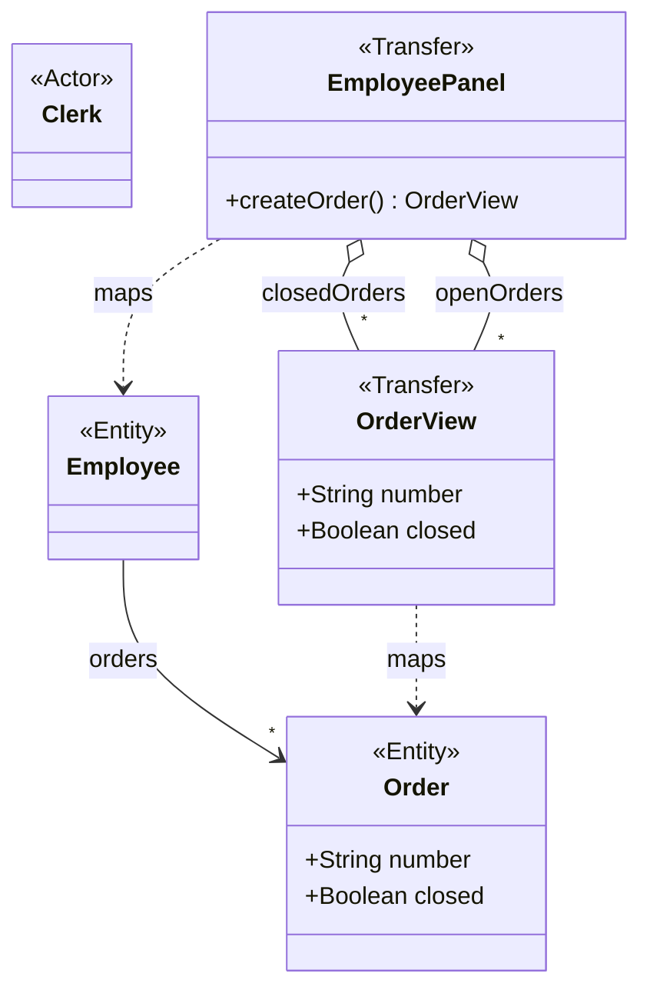

## Intent

A screen shows several differently filtered collections at once and offers creation or bulk actions ("my open orders", "my closed orders", a New button). Give that screen its own transfer object, the panel, and make it the target of the actor's access, instead of showing a single entity view.

## Practice

### The panel is a view model

The agent-docs describe this as the *View Model (Dashboard)* pattern ([advanced modeling patterns](../../agent-docs/model/advanced-modeling-patterns.md)): small data-focused transfer objects describe the items; one higher-level transfer object represents the screen; its contextual relations are `DERIVED`, each with its own getter expression that fetches and filters one data set; the actor's access targets the panel. Name it with a `Panel`, `Dashboard` or `List` suffix (project naming convention).

### Mapped panel or unmapped panel

A panel reached through an actor access must be **mapped**: EVL rejects an access whose target is an unmapped transfer object (`Access target have to be mapped`, see the View Model pattern in the [advanced modeling patterns](../../agent-docs/model/advanced-modeling-patterns.md)). Map the panel to the entity the screen is about and keep its relations derived. An unmapped panel works only as an operation input or output. Older wording that called the panel unmapped is superseded; check it in your own model. The reliable shape that validates is a panel **mapped** to the entity that represents the actor's workspace (typically the user or employee entity) and reached through a derived access whose getter returns that entity (see [[self-access-point]] and [[derived-access-filtering]]). The derived relations then start from `self`.

### Host the screen's operations on the panel

Creation operations (`createOrder`) and bulk operations (`approveAll`, `inviteBulk`) live as operations of the panel. A static operation needs a container transfer object or entity; the panel is a natural one. Operations are covered in the [operation reference](../../agent-docs/model/esm_metamodel/operation.md); a Java implementation (`customImplementation`) is the usual choice when the body does more than a script.

### Keep panels small and role-specific

One panel per screen and per actor role. If the panel collects dozens of operations, split by task. Authorization flags (for example "is the actor an admin") can be derived members of the panel; the generated UI evaluates them through `hiddenBy` / `enabledBy` ([UI authoring guide](../../agent-docs/model/ui-authoring-guide.md)).

## Rationale

- The screen's structure is decoupled from the domain model's structure: the panel aggregates and filters sources purpose-built for the page.
- Menu entries (actor accesses) point at one stable object per screen.
- Costs: one more transfer object per screen, and it can bloat if every operation is hung on it.

## Example

A neutral Employee entity owns a collection of Order entities. `OrderView` maps Order. `EmployeePanel` maps Employee and carries two derived relations of OrderView, `openOrders` and `closedOrders`, filtering the employee's own orders, plus a static `createOrder` operation that returns an OrderView. Actor Clerk has one derived access `panel` of cardinality 0..1 whose getter returns the employee row, targeting EmployeePanel. Used in this shape across the projects: task and item panels, admin dashboards with many creation operations, booking panels, and dashboards mapped to the user entity.

## When to avoid

- A plain list or detail of one entity with its own CRUD pages: use that entity's transfer object directly.
- The screen needs a single filtered collection: a derived access on the actor is enough.
- Many unrelated operations: split by task or use the transfer-object organization in [[service-based-transfer-organization]].

## Related

- [[service-based-transfer-organization]] — where panels sit among a service's transfer objects
- [[unmapped-transfer-dto]] — unmapped transfer objects and their limits
- [[derived-access-filtering]] — derived accesses that root the panel
- [[self-access-point]] — the actor's own row as access root

## Structure diagram

