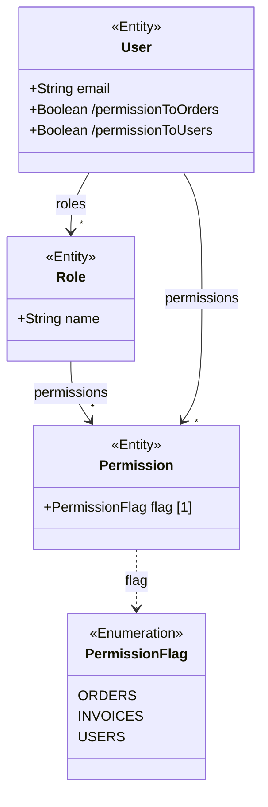

## Intent

One actor type covers all users, but each user may use only some feature areas. Model the feature areas as an enumeration, group them into roles, and expose one boolean per feature on the user so the UI can hide menu items and pages.

## Practice

### Flag enum, permission, role, user

- `PermissionFlag` is an enumeration with one member per feature or module (orders, invoices, users).
- `Permission` is an entity with a required `flag` of that enumeration.
- `Role` holds a collection of permissions; `User` holds a collection of roles (associations).
- `User` has a derived relation `permissions` that flattens the permissions of all roles, and one derived boolean `permissionTo<Feature>` per flag: true when some permission of the user has that flag (an `!exists` over `permissions`).

The derived members are ordinary derived expressions ([model development](../../agent-docs/model/model-development.md)); an enumeration literal is written `Type#MEMBER` and compared with `==`.

### Feed the UI through the principal's booleans

The platform documents the UI side: `hiddenBy` on a menu item access must reference a boolean `DataMember` on the principal transfer object, and `hiddenBy` hides when *true*. See [advanced modeling patterns, Hiding menu items by role](../../agent-docs/model/advanced-modeling-patterns.md) and the [UI authoring guide](../../agent-docs/model/ui-authoring-guide.md). So expose the permission booleans on the principal transfer object, in the negated form (a derived `not self.permissionToOrders`) when you want to hide for users without the right. The booleans only control the UI; the backend must still check the permission in access getters or interceptors (see [[ui-control-transfer-fields]]).

### Derived versus stored flags

The original project kept the booleans as stored attributes (default false) refreshed by a `recalculatePermissions` operation. Deriving them as shown removes the refresh step and the stale-flag risk, at the cost of evaluating the role chain on every read. The agent-docs also describe a simpler variant: a single stored role flag on the principal entity for coarse roles. Choose that when there are only one or two roles; choose the permission enum when features are many.

## Rationale

- Feature rights are data, editable without a model change; new roles need no code.
- One boolean per feature keeps UI conditions to a single reference, which is all `hiddenBy` and `enabledBy` accept.
- Cost: adding a feature means a new enum member plus a new derived boolean (and its page wiring). The project had 23 such pairs.

## Example

A neutral model: enumeration `PermissionFlag` (orders, invoices, users), entities `Permission`, `Role`, `User`. `Role.permissions` and `User.roles` are 0..* associations. `User.permissions` is derived as the roles' permissions; `User.permissionToOrders` and `User.permissionToUsers` are derived booleans over it. One project's flag set has changed size over time: its current role enum has 12 members, each with a stored boolean on the user.

### Source evolution (2026-11-10)

The source project has since replaced the Permission entity with a Role entity whose identifier is a role-flag enumeration (`User.roles`); a `recalculatePermissions` operation remains. The practice itself stays valid.

## When to avoid

- Two or three coarse roles: one stored role flag on the principal is simpler.
- Permissions per record (ownership): use access getters that filter by the actor ([[derived-access-filtering]]).
- Rights decided by the identity provider's groups only.

## Related

- [[ui-control-transfer-fields]] — booleans that drive hiding and enabling
- [[entity-crud-at-service-layer]] — service-layer organisation the permissions guard
- [[toggle-operation-pattern]] — operations that change flags
- [[enum-sentinel-value]] — other enum conventions

## Structure diagram

<!-- mermaid:generated fragment=permission-flag-enum cli=1.1.0.20261108_202643_d9769d90_develop -->

<!-- /mermaid:generated -->
