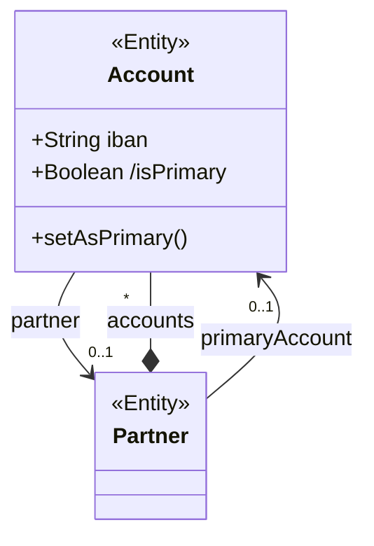

## Intent

An entity owns several similar items (bank accounts, addresses, phone numbers) and one of them is the default. Model the choice so that exactly one item can be primary and the parent always knows it.

## Practice

### Store the choice as a single reference on the parent

- The parent owns the items as a composition collection `accounts` (0..*), see [[composition-ownership]].
- The parent has an association `primaryAccount` (0..1) to an item. Because there is one reference, at most one item is primary: no toggle logic has to clear a previous flag.
- The item has an instance operation `setAsPrimary` (`togglePrimary` when it can also clear the choice). It sets the parent's `primaryAccount` to the item itself. The operation writes, so it is `stateful` ([operation reference](../../agent-docs/model/esm_metamodel/operation.md), statefulness section).
- The item reaches its parent through a derived back-reference `partner` (0..1) whose getter is `self!container(Partner)`; the `!container(type)` function returns the container of an instance that is part of a composition ([model development, collection and instance functions](../../agent-docs/model/model-development.md)). See [[container-back-reference]].
- A derived boolean `isPrimary` on the item (`self.partner.primaryAccount == self`) lets pages mark the primary row.

### Variant: flag on the item

The second observed shape stores `isPrimary` as a boolean on each item and derives the parent's `primaryAccount` by filtering the collection on the flag. This variant does not by itself prevent two flagged items; `setAsPrimary` must clear the others. The single-reference form is preferred.

### Practice note, not platform behaviour

Single-primary is a modelling convention. The platform has no uniqueness rule for a flag; the guarantee comes from the single reference and the operation. The agent-docs do not say what happens to the reference when the primary item is deleted, so test or handle that case (for example clear the reference first).

## Rationale

- The parent can read the default item directly, with no filter at read time.
- The operation is the only writer, so the rule is in one place.
- Cost: both a collection and a single reference on the parent; for the flag variant, extra clearing logic.

## Example

A neutral Partner owns `accounts` (composition, 0..*) and has `primaryAccount` (association, 0..1). Account has an `iban`, a derived `partner` back-reference using `!container`, a derived boolean `isPrimary` and a stateful instance operation `setAsPrimary`. One project used the single-reference form for bank accounts, e-mails, phones and addresses of partners, users and company data. Another used the flag variant: an `isPrimary` boolean per address and contact with a derived `primaryAddress` and `primaryContact`.

## When to avoid

- No default is needed: a plain collection is enough.
- Several primaries per purpose (a primary billing and a primary shipping address): use one reference per purpose.
- The items are not owned by one parent: there is no single container to hold the reference.

## Related

- [[toggle-operation-pattern]] — operations that flip state
- [[composition-ownership]] — the owning collection
- [[container-back-reference]] — the derived link from item to parent

## Structure diagram

