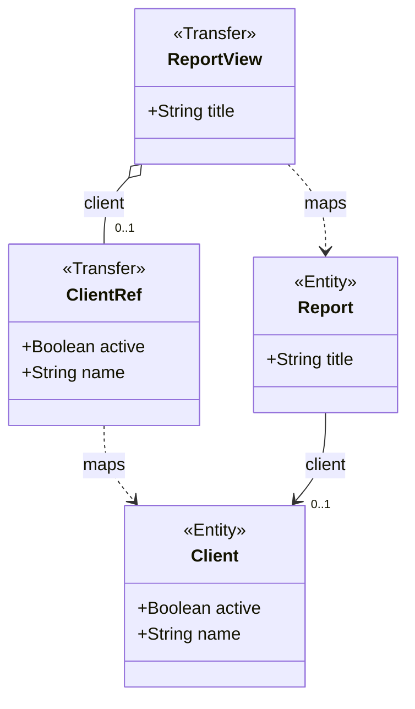

## Intent

When a user picks the target of a relation (a client for a report, approvers for a task), only valid candidates should be offered: active clients, approved questions, eligible users. State that rule on the relation in the model.

## Practice

### Set a derived range on the transfer relation

On a transfer object relation that can be edited (a mapped relation that is not read-only, or a transient relation) the model has two range attributes: `rangeType` (`ANY` or `DERIVED`) and `rangeExpression`, a JQL expression used when the type is `DERIVED`. The same pair exists on operation inputs, where a `DERIVED` range requires a non-blank expression ([operation reference](../../agent-docs/model/esm_metamodel/operation.md)). The generated reference selector (the `GET_RANGE` operation) takes its options from that range.

- Write the expression as a filter over the target entity: `Client!filter(c | c.active)`. Typical filters are an active flag ([[soft-delete-active-flag]]) or a status enumeration literal ([[enum-state-machine]]).
- Add `!sort(c | c.name ASC)` for ordered pickers. The collection-function syntax is in [model development](../../agent-docs/model/model-development.md).
- Dependent pickers: the project observations (two projects) start the expression from `self`, for example "the items of the selected group". The agent-docs do not describe `self` in range expressions, so verify each such expression in your model.

### A range is not a security boundary

With `rangeType = ANY` every instance is exposed, and the platform notes that a range *interceptor* (firing on the `_getRangeReference*` operations) is the security boundary for such relations ([interceptors](../../agent-docs/backend/interceptors.md)). A `DERIVED` range narrows the picker; whether the server also rejects a value outside the range when the relation is set is not stated in the agent-docs. Validate selected targets in an operation or interceptor when the rule matters.

### Keep it a filter

The range is a plain expression. Put complex rules into a derived boolean on the target entity (`isActiveProfessional`) and filter on that.

## Rationale

- The business rule sits next to the relation, and the generated UI shows only valid options without custom code.
- Pickers can be sorted without frontend work.
- Cost: only filter and sort logic; rules that need other state must be derived onto the target first.

## Example

A neutral Report entity has an association `client` to Client. The `ReportView` transfer object maps Report and exposes `client` (type `ClientRef`, mapping Client) with a derived range: `Client!filter(c | c.active)!sort(c | c.name ASC)`. The picker shows only active clients, sorted by name. The projects used the same shape: one offered only approved entries, one only active approvers, one active entries with ordered levels, and two only active clients and companies.

## When to avoid

- Every instance is a valid choice: leave the range at `ANY`.
- The rule depends on large computation per candidate: derive a flag on the target instead.
- The restriction is a security rule: enforce it with access getters or a range interceptor.

## Related

- [[enum-state-machine]] — status enumerations used as filter criteria
- [[derived-access-filtering]] — the same filter idea applied to accesses
- [[soft-delete-active-flag]] — the active flag most ranges test

## Structure diagram

