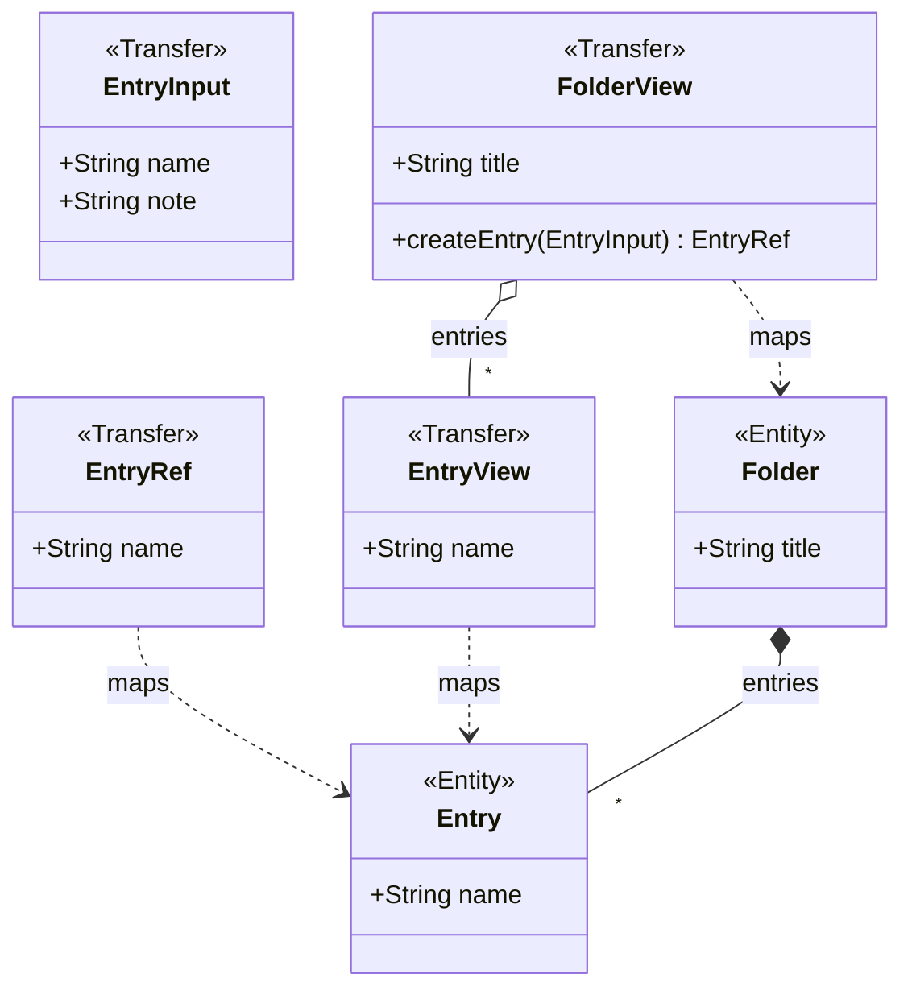

## Intent

Read this before designing an access, a custom operation or an admin surface. It covers four connected ideas: a relation to a mapped transfer object generates its own screens, a create whose shape differs needs a custom operation, the operation's return type steers the UI, and a ladder of conditions decides whether create, update or delete is possible at runtime.

## Practice

### The relation target generates the screens

A list relation (a derived or mapped relation on a transfer object, or an actor access) gets its UI from the mapped target transfer object `Y`:

| Flag | Generated UI |
|---|---|
| always | table with the mapped attributes of `Y` as columns; row click opens a detail form bound to `Y` |
| `Y.updateable` | editing on the detail form |
| `Y.createable` | an add action with a create form from the attributes of `Y` |
| `Y.deleteable` | a delete action |

The access reference states the same: an access with list cardinality renders a table page and the target needs table columns ([accesspoint reference](../../agent-docs/model/esm_metamodel/accesspoint.md), *UI Requirements on the Target TO*). An actor access and a plain relation differ in security gating (`enabledBy`, getter filter, list scope), in routing (an access gets a menu item, see [[access-paired-with-menu-item]]) and in the principal back-link rules ([accesspoint reference](../../agent-docs/model/esm_metamodel/accesspoint.md), *Principal back-link exclusivity*), not in form or table generation. The row-by-row mapping table above is the project's reading; check it against your generator version (*verify*).

**One transfer object per relation target.** Table, detail, create and edit all come from one `Y`, so nothing drifts. Thin the columns by hiding technical attributes, not by adding a second list-only transfer object. See [[actor-based-transfer-projection]] and [[transfer-object-multiplicity]].

### Custom operation when the create shape differs

When the input fields differ from the attributes of `Y` (an invitation with email and names, a composite create with a parent reference, a factory that picks a subtype), do not bend `Y`:

1. Declare an unmapped transfer object for the input ([[unmapped-transfer-dto]]); its CRUD flags do not matter.
2. Declare the operation on the parent, the view model or the access target.
3. The body creates the entity through the DAO and returns a mapped transfer object. The custom body is project code.

A transfer object used as a create target must bind every required feature of its entity, or validation fails (`AllRequiredFeaturesHaveBindingIfCreatable`, [validation options](../../agent-docs/model/model-validation-and-transformation.md), *Creatable transfer objects*).

**Return shape:** for a create-on-relation operation, return a thin mapped reference of the new row rather than the full target; see [[thin-identifiable-result-for-parent-relation-create]].

### The return type steers navigation

Project reading, partly backed by the docs:

| Operation output | Default UI landing |
|---|---|
| mapped transfer object | the generated standalone view of that type, re-fetched by the signed identifier |
| unmapped transfer object | an inline view-mode form on the caller page; no identifier, so no re-fetch (*verify*) |
| nothing | stay on the caller page and refresh |

The platform's declarative route is the operation form's post-call access navigation ([[operation-return-type-navigation]]). For dynamic targets a frontend `OperationFlowManager` returns actor and access plus an optional id filter, an operation, or a refresh ([[operation-flow-manager-redirect]], [[operation-flow-redirect-pattern]]).

**One representation per concept.** The standalone view and the access-context detail of the same row are two generated pages that drift. Pick the access-context view as canonical and redirect every post-operation landing into it; the standalone route is generated but not visited. Update and delete on the landing page depend on the target row's per-instance flags in the redirect target's context, not on the caller's.

### Capability ladder

Create, update or delete on `Y` through `X.relY` needs all rungs:

| Rung | Create on Y | Update on Y | Delete on Y |
|---|---|---|---|
| 1. Y outer flags | `Y.createable` | `Y.updateable` | `Y.deleteable` |
| 2. Relation or access flag | create flag | update flag | delete flag |
| 3. Access reachability | `enabledBy` chain to X | same | same |
| 4. Parent per-instance flag | `X.__updateable` | `X.__updateable` | `X.__deletable` |
| 5. Filter membership after the change | new row matches the getter filter | updated row matches | not applicable |
| 6. Visible in the list scope | row listed | same | same |

The access reference names the ladder and lists its rungs (*Access CRUD Rules*). Rungs 1–3 are decided in the model, 4–6 per request. Rung 5 is [[derived-relation-membership-invariant]]. Rung 6: a caller only gets a signed identifier for rows the list returns ([platform behavior reference](../../agent-docs/backend/platform-behavior-reference.md), *Signed Identifiers*).

- The outer flags of `Y` state the maximum capability wherever `Y` is shown; the request still walks the whole ladder.
- A custom operation on X is not subject to this ladder. It has its own gate (`enabledBy`) and body logic, and may touch rows the ladder forbids. Interceptors never run around custom operations either, so checks belong in the body.

## Rationale

- One mapped transfer object per relation target means one place to change a screen.
- A custom operation keeps the auto-generated forms honest when the input shape truly differs.
- Knowing the ladder explains why a button is missing even though `Y.createable` is true.

## Example

A folder view has an entries relation to a mapped entry view (createable, updateable, deleteable). The table, detail and delete action come from the entry view. The folder view's `createEntry` operation takes an unmapped entry input (a name and a note) and returns a thin entry reference. The diagram shows this shape. Observed in compsych-letter-demo.

Anti-patterns seen:

- A separate list-only transfer object for the relation target: row click needs a custom handler to reach the real detail. Use one transfer object and hide attributes.
- `Y.createable` when the create input differs from the attributes of `Y`: the auto form is the wrong shape. Use the custom operation.
- Making `X` updateable only so that its children can be edited: it opens the parent for unintended updates (self-elevation risk on principal entities). Give each of create, update and delete its own operation with `enabledBy`; see [[managed-actor-admin-pattern]].
- Two maintained views for one row (standalone plus access-context). Redirect into one.
- A create-on-relation operation that returns the full target just to carry the identifier: return the thin reference.

## When to avoid

- The create input matches the attributes of `Y`: use the generated create, no custom operation.
- A read-only relation (no create, update or delete): the ladder is irrelevant.

## Related

- [[derived-relation-membership-invariant]] — rung 5, write-side membership
- [[thin-identifiable-result-for-parent-relation-create]] — return shape of create-on-relation operations
- [[operation-return-type-navigation]] — return type to view navigation
- [[operation-flow-manager-redirect]] — redirect into the access-context view
- [[managed-actor-admin-pattern]] — admin surface combining custom operations, redirect and the ladder
- [[actor-based-transfer-projection]] — several transfer objects over one entity
- [[state-based-transfer-partitioning]] — partitioning as the rung-5 workaround

## Structure diagram

<!-- mermaid:generated fragment=relation-driven-crud-with-custom-input cli=1.1.0.20261108_202643_d9769d90_develop -->

<!-- /mermaid:generated -->
