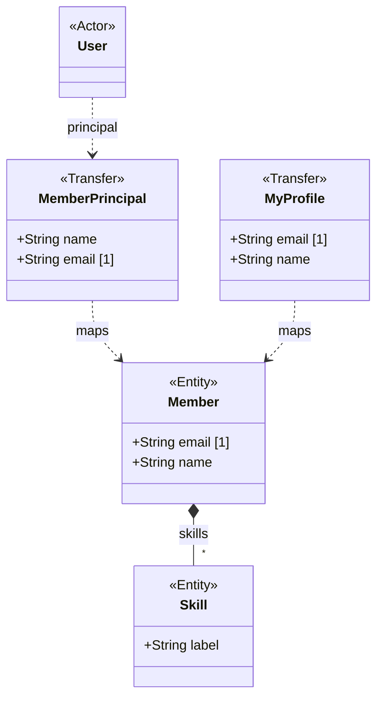

## Intent

A signed-in user needs an entry point to their own record: a profile to edit, or a personal dashboard of their data and actions. Model it as an access of cardinality 0..1 on the actor that resolves to the user's own entity row.

## Practice

### Resolve the actor's row in the getter

The old project notes describe the getter as `self`. The agent-docs correct this: an `ActorType` access getter **has no `self`** (it runs at actor scope) and must start from the **entity** FQN, not from a transfer object ([model development, section 5.4](../../agent-docs/model/model-development.md) and [architectural patterns, rules for access getters](../../agent-docs/backend/architectural-patterns.md)). The access is `DERIVED` and returns a reference. To reach the actor's row, filter the principal entity by the identifying claim value:

- `Member!filter(m | m.email == <String>!getVariable('ACTOR', 'email'))!any()`, with the primitive type fully qualified. `!getVariable` returns a scalar, so compare with `==`.
- `ACTOR` values are populated only for the *managed mapped principal* shape: a mapped principal transfer object, `managed = true`, and a claim attribute that maps to an identifying entity attribute ([accesspoint reference, three actor shapes](../../agent-docs/model/esm_metamodel/accesspoint.md)). Other shapes use `USER` or `PRINCIPAL` and see [advanced modeling patterns, ACTOR vs PRINCIPAL vs USER](../../agent-docs/model/advanced-modeling-patterns.md).
- `!any()` collapses the filtered collection to one instance, as an access of cardinality 0..1 requires; use it once and at the end of the chain.

The "fully user-scoped" pattern in the same agent-doc builds all other accesses from this root.

### Target a profile transfer object

The access targets a transfer object mapped to the same entity as the principal (the principal transfer object itself is not publicly creatable or editable, so use a second projection). Put editable relations and self-service operations on it, and allow only update on the access: the user edits their profile, but cannot create or delete it. See [[actor-based-transfer-projection]] and [[transfer-generalization]] (inheritance between transfer objects is limited; check there).

### Several self accesses, one per purpose

Different accesses may each resolve to the same row with a different target: a profile editor, an approval overview, a bulk-action dashboard ([[panel-dashboard-transfer]]). Each access needs a matching menu item to be reachable in the UI ([accesspoint reference, pairing rule](../../agent-docs/model/esm_metamodel/accesspoint.md)). Model tooling may create this `MenuItemAccess` together with the access; check for it and do not add a second one ([model development guide](../../agent-docs/model/model-development.md), Part 2).

## Rationale

- Data isolation: the user works on a graph rooted in their own row; other accesses navigate from it.
- Simple and declarative: no per-request code.
- Cost: single-row only, and the lookup needs the managed principal shape; with other shapes the row is found through a claim lookup with extra cost per evaluation.

## Example

A neutral Member entity has a required, identifying `email` and owns Skills. The actor `User` is a managed actor whose principal transfer object maps Member and carries an email claim. A second transfer object, `MyProfile`, maps Member too. The actor has one derived access `profile` (cardinality 0..1, update allowed) that returns the Member whose email equals the actor's email, targeting `MyProfile`. Three projects used this shape for profile and dashboard entry points.

## When to avoid

- The actor has no persisted principal row (token-only or transient principal): there is no row to return.
- The user needs a list of several records: use a filtered derived access ([[derived-access-filtering]]).
- Anonymous actors.

## Related

- [[derived-access-filtering]] — other derived access getter forms
- [[actor-based-transfer-projection]] — one transfer object per actor role
- [[transfer-generalization]] — extending the principal projection
- [[panel-dashboard-transfer]] — dashboards reached through such an access

## Structure diagram

