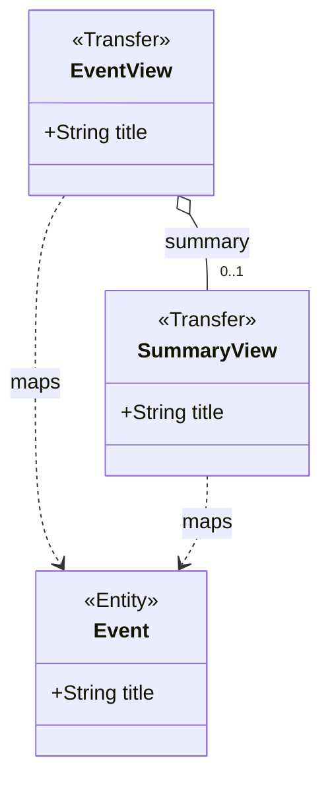

## Intent

One page needs the same entity in two shapes: for example an event's own details and, next to them, its summary with different attributes and filters. Give the first transfer object a derived relation to the second one, and let the relation return the same row.

## Practice

### The relation returns the current instance

On the first transfer object define a derived relation (cardinality 0..1) with the getter `self` and a target transfer object that maps the same entity but projects other attributes or derived collections. In a transfer object getter `self` is the mapped instance ([model development](../../agent-docs/model/model-development.md); `self` as a relation is listed in [[derived-relation-navigation]]). The generated UI can then show the relation as a nested view of the second projection.

### Why not an access getter

This works because the getter runs on a transfer object. On an actor's access the getter has no `self` and must start from the entity ([architectural patterns, rules for access getters](../../agent-docs/backend/architectural-patterns.md)); for the actor's own row see [[self-access-point]].

### Keep the projections distinct

The second transfer object should add something the first lacks (other attributes, filtered collections such as personal bests). If both views are the same, just reuse one transfer object. For several views per consumer see [[transfer-object-multiplicity]].

## Rationale

- No extra query model or stored duplicate: the same row is projected twice.
- The UI keeps a clean split between the two concerns.
- Cost: a relation that points "at itself" is surprising; document it. The agent-docs do not cover nesting limits or update behaviour of such a relation, so treat it as read-only.

## Example

A neutral Event entity is mapped by two transfer objects, `EventView` and `SummaryView`. `EventView` has a derived relation `summary` (0..1) to `SummaryView` with getter `self`. A page of `EventView` shows the event and, inside it, the summary projection. The original project used it for a participant-side view of an event and its summary.

## When to avoid

- The second view needs other rows: use a normal derived relation ([[derived-relation-navigation]]).
- One flat view suffices.
- Edits through the nested projection: the practice treats the relation as read-only.

## Related

- [[actor-based-transfer-projection]] — different projections per role
- [[derived-attribute-flattening]] — derived members of the same projection
- [[derived-relation-navigation]] — the other derived relation forms
- [[transfer-object-multiplicity]] — several transfer objects over one entity
- [[self-access-point]] — the access-level counterpart

## Structure diagram

