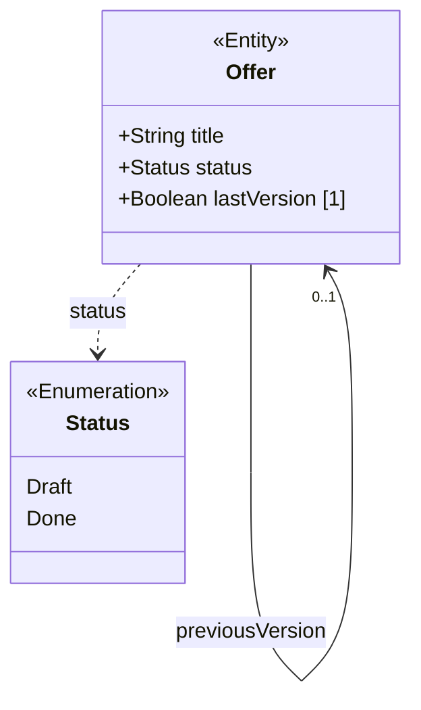

## Intent

Keep the full history of an entity inside a single entity table. Each version points to the version it replaced, and one flag marks the current version.

## Practice

### Shape: previous-version link plus current flag

- The entity has an optional (`0..1`) self-referencing relation `previousVersion` to its own type.
- The entity has a required boolean `lastVersion` whose default expression is `true`.
- Use an association for the link. The agent-docs state that a unidirectional entity relation may be an association; relation kinds are a design choice (see [Asymmetric bidirectional relations](../../agent-docs/model/advanced-modeling-patterns.md)). Do not add the opposite end as a second association or composition: bidirectional relations are validated asymmetrically (one aggregation end, one association end) and at least one end needs a lower bound of zero.

### Creating a version is a custom operation

The platform generates plain create, update and delete. The version-creation step is project practice implemented in a custom operation (see [data access guide](../../agent-docs/backend/data-access-guide.md)):

1. Copy the current entity into a new row.
2. Set the copy's `previousVersion` to the original.
3. Set the original's `lastVersion` to `false`; the copy keeps `true`.

Run all three writes in the one operation call, so a failure leaves no half-linked chain. Each write bumps the entity's `__version` (optimistic locking), and the signed identifier changes after every update ([signed identifiers](../../agent-docs/backend/platform-behavior-reference.md)), so a client must re-read the instance after the operation instead of reusing an identifier it stored earlier.

### Read the current version

Collections for pages and queries filter on `lastVersion = true`. The history is reached by following `previousVersion` link by link.

## Rationale

- No separate version table, simple linked-list history, easy query for the current version.
- Cost: old versions stay in the same table, so heavily versioned entities grow it; walking the history needs one hop per version.
- The flag is redundant with the chain (the current version is the one nobody points to). It is kept because filtering on a stored boolean is cheaper and simpler than a "not referenced" expression, but nothing in the platform keeps the two consistent. The operation above must.

## Example

An Offer has `title`, a `status` (Draft, Done), `lastVersion` (default true) and `previousVersion` pointing to another Offer. A `generateNewVersion` operation clones the offer, links the clone to the original and flips the flags. Offer pages list only offers whose `lastVersion` is true. The original project (RackInspect) combined this with a status workflow and cost fields to keep a pricing history. The names here are neutral stand-ins.

## When to avoid

- Versions own child data that must be frozen with them: use [[snapshot-versioning-pattern]], which copies children into separate version entities.
- History is rarely read and the table would grow large: keep history in a separate entity.
- Several writers can create versions of the same entity concurrently without a guarded operation: the chain can fork.

## Related

- [[snapshot-versioning-pattern]] — alternative: clone child data into separate version entities
- [[enum-state-machine]] — status lifecycle often combined with versioning

## Structure diagram

<!-- mermaid:generated fragment=self-referencing-versioning cli=1.1.0.20261108_202643_d9769d90_develop -->

<!-- /mermaid:generated -->
