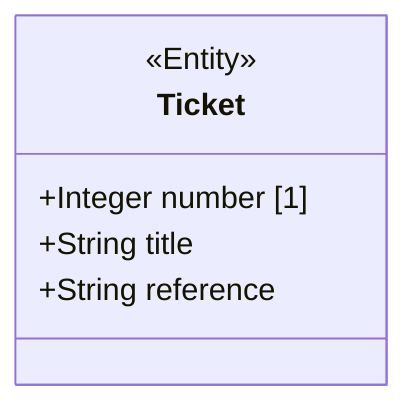

## Intent

Give each new row an automatically assigned number, either a plain counter or a readable identifier such as `TCK00042`, without client input.

## Practice

### Default expression on a stored attribute

- The attribute is a stored (not derived) member of the entity, required, usually an `Integer` or `Long`. It may be marked as the entity's identifier attribute.
- Its default expression reads the `SEQUENCE` variable category: `<Type>!getVariable("SEQUENCE", "<SequenceName>")`. The platform documents `SEQUENCE` as one of the variable categories (`SYSTEM`, `ENVIRONMENT`, `REQUEST`, `ACTOR`, `PRINCIPAL`, `SEQUENCE`), backed by database sequences. `getVariable` is typed by the primitive it is called on and returns a scalar; an undefined variable resolves to `null` with a warning ([model development guide](../../agent-docs/model/model-development.md)).
- Use one sequence name per number space, typically the entity name. Two entities that share a name share a counter.

### Readable identifiers: format in the expression

Wrap the value: a prefix, `asString()` and `lpad(width, "0")` give `PREFIX00042`. `lpad`, `asString` and the other string functions come from the framework function library ([JSL built-in libraries](../../agent-docs/model/jsl-language-notes.md)). The width is fixed in the expression, so numbers beyond it grow longer, they do not wrap.

### Keep the number read-only for users

Expose the attribute on transfer objects as a read-only (derived or mapped, non-editable) member, or leave it off the actor-facing transfer object. Then the form shows it but nobody types over it.

### Count-based variant on a transfer object

One project put the default on the transfer object instead: `'APP-' + ((Application!count()+1)!asString())!lpad(4, "0")`, so the creation form is pre-filled. This is a convention, weaker than a sequence: the count falls after a delete (a number can be issued twice), and two concurrent creates can read the same count. It is only suitable for small, rarely deleted registers.

### Platform facts that limit the pattern

- Sequences can have gaps; values of rolled-back transactions are not reused. Do not promise gap-free numbers.
- The default sequence type is `rdbms`. A custom sequence implementation can replace it (OSGi component for the platform `Sequence` interface); transient sequences are not supported on multi-node deployments ([custom sequences](../../agent-docs/backend/platform-behavior-reference.md)).
- Uniqueness of the value follows from the sequence, but the platform docs do not describe a unique constraint on identifier attributes. Do not rely on the model to reject a manually set duplicate.

## Rationale

- Uniqueness and ordering come from the database, not from application code.
- The expression lives in the model, so every client and the API get the same behavior.
- Sequential numbers reveal record counts and do not work across systems without coordination.
- The same mechanism also serves as an ordering key: one project uses a required `sequence` attribute on an event entity to process events in order, not as a business identifier.

## Example

A Ticket entity has a required `number` (Integer, identifier attribute, default from the `Ticket` sequence), a `title`, and a `reference` string whose default is `"TCK"` plus the zero-padded value of a second sequence (`TCK00001`). Three projects used the same shape: one with an Integer number instead of Long, one with a fixed prefix and width 5. Names are neutral stand-ins.

## When to avoid

- You need gap-free, per-period or prefixed document numbers with locking: see [[document-registry-sequence]].
- Identifiers must be created offline or across systems: use a generated unique id instead.
- Numbers must stay secret: sequential values leak volume.

## Related

- [[default-value-patterns]] — the wider set of default expression conventions
- [[document-registry-sequence]] — gap-free, per-period numbering built in project code
- [[composite-identifier-pattern]] — identifiers made of several attributes

## Structure diagram

