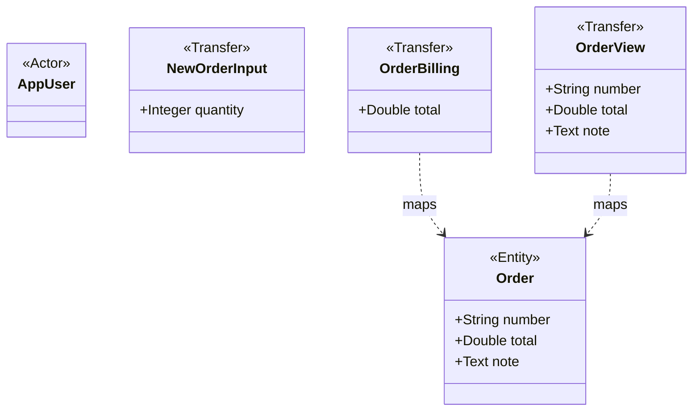

## Intent

Organize the transfer layer by business service. One package per domain holds the mapped views, the unmapped inputs and the dashboard objects of that domain. A single actor (or a few) reaches all of them. This is the alternative to giving every actor its own transfer package.

## Practice

### One package per domain, entities apart

- Entities live in their own package (for example `entities`). A root `services` package has one sub-package per domain.
- A service package holds three kinds of transfer objects, as defined in the [model development guide](../../agent-docs/model/model-development.md): mapped transfer objects (a projection of one entity, with mapped, derived and transient members), unmapped transfer objects (no entity; typically operation inputs and outputs) and panel or dashboard objects (unmapped entry points for pages).
- The same entity can be mapped by transfer objects in several service packages, each with the member selection that domain needs.

### Reach the packages through Access entries

Each ActorType needs an Access entry per transfer object it may reach, and a paired MenuItemAccess for every page that should appear in the menu: an Access is a data-permission grant only ([accesspoint reference](../../agent-docs/model/esm_metamodel/accesspoint.md)). With one actor, that actor holds Access entries into every service package.

### Permissions are a project layer on top

The platform gives per-actor access and an optional row filter on the Access. When all users share one actor, differences between users are modelled by the project: a role flag on the user entity (for example `isAdministrator`, `permissionTo...`), used in `hiddenBy` / `enabledBy` expressions on menu items and actions, and checked again in operations or interceptors. This is project practice, not platform enforcement. UI hiding alone does not stop an API client, so the server side must check too.

### Naming

Functional suffixes keep a large package readable: `*Transfer` or `*View` (mapped), `*Input` (creation or action input), `*Settings`, `*Panel` (dashboard or list entry), `*Info`.

### Variations seen

- Several actors sharing one service namespace (ReserveApp: admin and partner-scoped objects in the same package).
- Two tiers (judo-partner): identity-mapped internal transfer objects for backend use, plus curated API objects with derived members and operations.
- Several access points per service for different roles (MLSZKSZ), hidden per role.

## Rationale

- Related functionality sits together whatever the caller, and transfer objects are not duplicated per actor.
- Works well when one user type has role-based permissions rather than fundamentally different actors.
- Cost: separate actors give platform-level isolation (own Access entries and row filters); with one actor every service is reachable by everyone, so project flags and server checks replace that. The set of packages can grow large (RackInspect: 14 packages, 142 transfer objects).

## Example

A model has an `entities` package with an Order entity (number, total, note) and an `AppUser` actor. The `orders` package holds OrderView (maps all three attributes) and NewOrderInput (unmapped, one transient quantity). The `billing` package holds OrderBilling (maps only the total). AppUser has one Access per mapped view. The same Order appears in two service packages with different projections. Names are neutral stand-ins for the project services.

## When to avoid

- Fundamentally different user types who must see different data: use [[actor-based-transfer-projection]].
- Strict isolation between roles is required and cannot rest on project flags.
- Only a handful of transfer objects: packages add nothing.

## Related

- [[actor-based-transfer-projection]] — alternative: per-actor organization
- [[unmapped-transfer-dto]] — the unmapped inputs and outputs inside each service package
- [[panel-dashboard-transfer]] — dashboard objects that act as package entry points

## Structure diagram

<!-- mermaid:generated fragment=service-based-transfer-organization cli=1.1.0.20261108_202643_d9769d90_develop -->

<!-- /mermaid:generated -->
