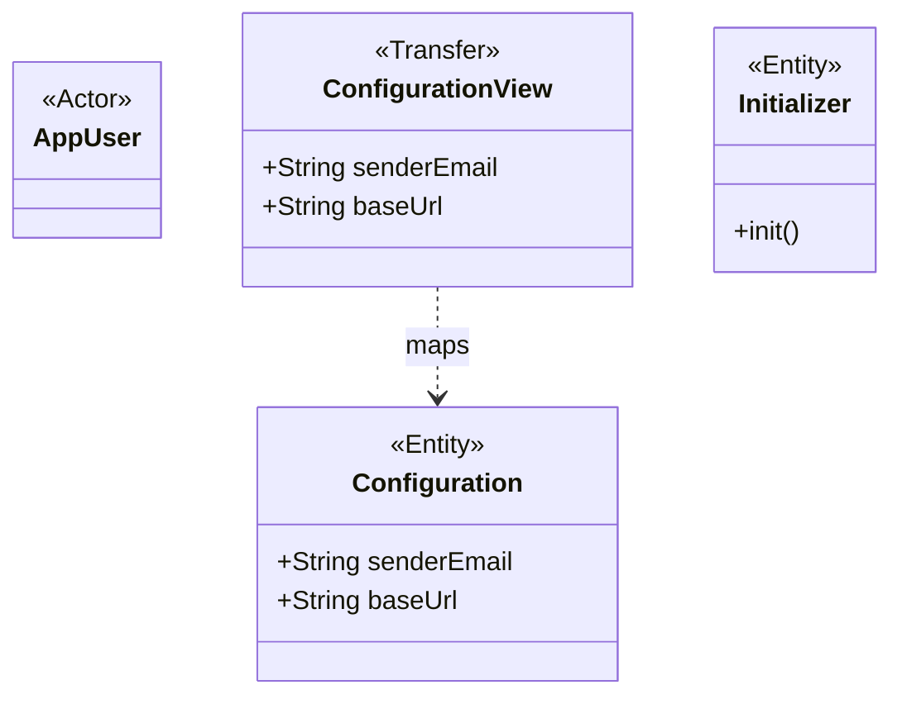

## Intent

Model application-wide state or entry points as an entity of which the project only ever keeps one row. Two variants occur: a data-carrying singleton for settings, and an attribute-less container that hosts static operations such as an initializer.

## Practice

### The platform has no singleton construct

"Singleton" is a convention. Nothing in the model stops a second row. The pattern is: an entity, a single-instance Access, and a project rule that only one row is created.

### Data-carrying singleton: settings

- An entity such as Configuration holds the settings (sender address, base URL, templates, credentials).
- The actor reaches it through an Access with upper bound 1 and a derived getter expression that ends in `!any()`. The agent-docs say `!any()` collapses a collection to one instance and is needed exactly when the final value must be a single instance, as for a singleton Access ([model development guide](../../agent-docs/model/model-development.md)). It may appear once per expression.
- Often update-only: the Access and transfer object allow update, not create or delete. The row is created by an initializer.
- The Access needs a paired MenuItemAccess to appear in the menu ([accesspoint reference](../../agent-docs/model/esm_metamodel/accesspoint.md)).

### Attribute-less singleton: initializer and application container

- An entity with no attributes or relations (named Application or Initializer) hosts static operations: an initializer that seeds data, registration, bulk actions. Operation type `INITIALIZER` is stored as a static operation with the initializer flag set ([operation reference](../../agent-docs/model/esm_metamodel/operation.md)). The platform calls every initializer operation (unbound, no parameters) at each start of the application, after the persistence, scripts, SDK operations and identity-manager services are ready. The startup code calls each one with an empty exchange map and sets no principal. A failing one is logged and the completion marker is not registered, so dependants that wait for it do not start. Guard the body so a later start changes nothing; see [[initializer-operation]] for the seeding practice.
- If clients should call its operations, expose the entity through the same single-instance Access. Several projects did not expose it at all: it exists only for startup seeding.

### First-run check

Operations that create the singleton row guard with a collection check (`!empty()` or `!count()`), so a second call changes nothing. The checks are JQL collection functions ([model development guide](../../agent-docs/model/model-development.md)). The guard is not atomic: concurrent first calls can still both create a row.

### Variants seen

- Two singletons side by side: an Initializer whose only attribute is `createdAt`, and a data-carrying Configuration (seen in two projects).
- One project split seeding across four domain-specific initializer operations, each guarded.
- One project keeps API credentials in a configuration entity read with `!any()` on the actor.

## Rationale

- One clear entry point for application-level operations and settings, and a natural home for seeding.
- Fits the actor access model: a single-instance Access is just a derived getter.
- Cost: the entity looks unusual, and the one-row rule is not enforced by the platform. Code that reads it must handle the case where it does not exist yet.

## Example

A Configuration entity has `senderEmail` and `baseUrl`. ConfigurationView maps both and is updateable. AppUser has one Access to it with upper bound 1, a derived getter `Configuration!any()` and update permission. A separate Initializer entity has no attributes and hosts one initializer operation `init`. Names are neutral stand-ins.

## When to avoid

- Settings that vary per tenant or per actor: use a normal entity with a row filter on the Access.
- A handful of constants needing no UI or editing: use a plain default expression.
- Operations that belong to a real entity: put them on that entity.

## Related

- [[initializer-operation]] — seeding the singleton row
- [[derived-access-filtering]] — the getter expression on the Access
- [[custom-implementation-placeholder]] — operations of the singleton implemented in project code
- [[platform-configuration-singleton]] — a data-carrying singleton blueprint
- [[single-access-entity-pattern]] — client-side fetch and create-if-missing for a single-instance Access

## Structure diagram

