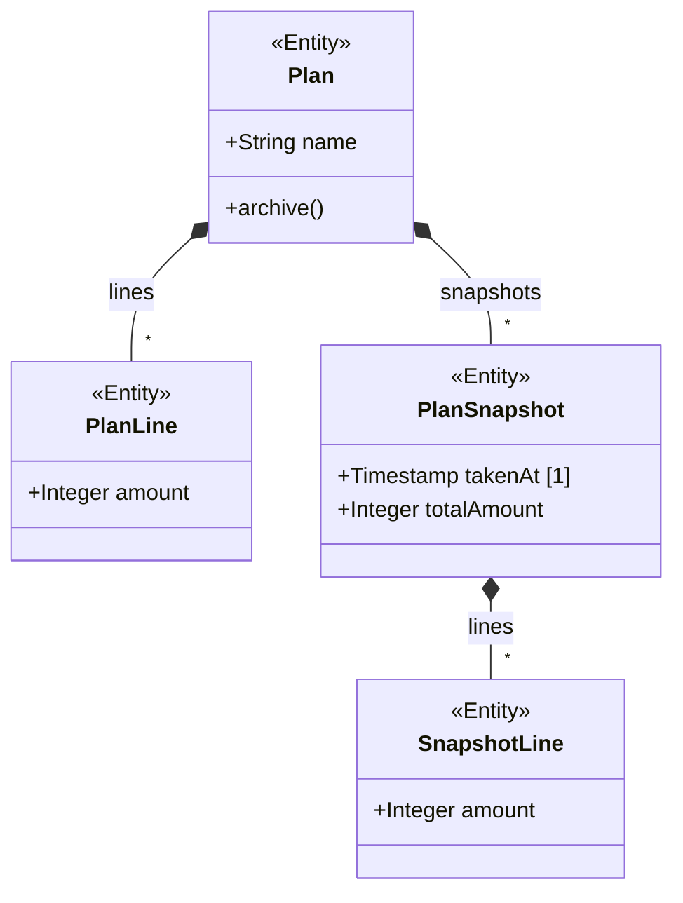

## Intent

Keep a parent entity editable while preserving what its data looked like at chosen moments. A snapshot is a separate entity that copies the key values (and child rows) at that moment and is not changed afterwards.

## Practice

### Shape: working data plus a collection of snapshots

- The parent owns its working children (for example `lines`) and a collection of snapshot entities (`snapshots`, `0..*`).
- A snapshot entity holds a timestamp, the copied attributes and optional summary values (totals) computed when it was taken. It can own copies of the child rows (`SnapshotLine`), which are a second entity type, not the live child type.
- Ownership relations use composition (the parent owns the snapshots and the snapshots own their lines), so deleting the parent removes its history. Associations are equally valid where history must outlive the parent; relation kind is a design choice ([relation kinds](../../agent-docs/model/advanced-modeling-patterns.md)). If a back-reference from the snapshot to the parent is wanted, remember bidirectional relations are validated asymmetrically (one aggregation end, one association end).

### Taking a snapshot is a custom operation

The platform generates create, update and delete only. The step "copy now" is a custom operation on the parent, written in project code with the generated DAOs ([data access guide](../../agent-docs/backend/data-access-guide.md)):

1. Create the snapshot with the timestamp.
2. Compute the summary values, with null-safe filtering ([[null-safe-collection-aggregation]]).
3. Copy each live child into a snapshot line and attach everything to the parent.

Do all of it in one operation call so a failure leaves no partial snapshot. Alternatively the update operation writes a history record with the previous values before it changes the parent (one project: five key fields plus a `changed` timestamp, written whenever a tracked value changes).

### Make snapshots read-only

Nothing in the platform makes an entity immutable by itself. Turn off the update and delete flags on the snapshot's transfer objects and access entries, and offer no operation that edits it. The agent-docs describe an `immutable` mark on signed identifiers that makes the dispatcher refuse operations on such instances, but they say it applies to instances produced from an `immutable` copy ([signed identifiers](../../agent-docs/backend/platform-behavior-reference.md)); do not rely on it for snapshots without checking.

### Finding the latest version

- Sort the snapshot collection by timestamp.
- Or keep a stored pointer to the latest (one project: a `currentVersion` relation next to the `versions` collection), which avoids a derived head expression. The pointer must be updated by the operation that adds a version.
- Or keep two pointers (one project: `head` for the latest, possibly uncommitted, and `published` for the active one). Upload creates a version, commit finalizes it, publish promotes head to published. This lets drafts be edited without touching production.

## Rationale

- The working data stays simple and editable; history is complete with timestamps and aggregates; each snapshot stands alone.
- Cost: duplicated data, a second entity type per snapshotted child, a larger entity graph. Pointer fields (`currentVersion`, `head`, `published`) can drift from the collection unless one operation owns them.

## Example

A Plan entity owns `lines` (PlanLine with an amount) and `snapshots` (PlanSnapshot with `takenAt` and `totalAmount`). Each PlanSnapshot owns its own `lines` of the copy type SnapshotLine. The operation `archive` on Plan creates a snapshot, sums the amounts, copies every line and attaches the result. This mirrors a plan archive seen in one project (a parent archives its monthly figures into a version). Names are neutral stand-ins.

## When to avoid

- The whole entity, not only some child data, needs a version chain: use [[self-referencing-versioning]].
- Only a change log is needed: use [[audit-event-entity]].
- Snapshots must stay when the parent is deleted and you chose composition: use associations instead.

## Related

- [[self-referencing-versioning]] — alternative: linked-list versioning of the entity itself
- [[composition-ownership]] — ownership relation for snapshots and their lines
- [[audit-event-entity]] — event-based audit trail instead of copies
- [[null-safe-collection-aggregation]] — summary values computed over optional data
- [[workflow-versioning-pattern]] — the head/published variant as a blueprint
- [[plan-versioning-snapshot]] — the plan archive as a blueprint

## Structure diagram

