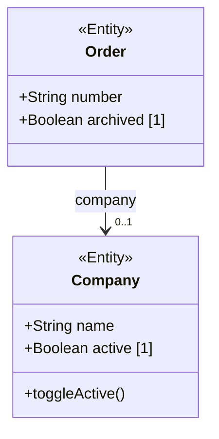

## Intent

Keep records that other data refers to. Mark them inactive instead of deleting them, so references and history stay intact and the record can be brought back.

## Practice

### The flag

- A required boolean stored attribute with a default expression: `active` or `isEnabled` defaulting to `true` (new rows are live), or the inverted `isArchived` defaulting to `false`. Pick one polarity per model.
- Variants: a status enumeration with a DELETED member (one project: draft, published, expired, pending review, deleted), or a two-value active/archived enumeration (seen in one project). Use an enumeration when the record has a richer lifecycle than on/off ([[enum-state-machine]]).
- A derived status can be computed from the flag and other state (one project derives ACTIVE, DRAFT or DELETED from `isArchived`).
- Platform delete stays available unless you turn it off. Soft delete is a convention: switch off the delete flag on the transfer objects and access entries for these entities (one project: the admin access has no delete permission), or the physical delete still works.

### Hide inactive rows where they are chosen or listed

The flag alone changes nothing; every reader must filter it.

- Pickers: give the relation a derived range expression such as `Company!filter(c | c.active)`. The relation's range type must be set to derived for the expression to apply ([operation reference](../../agent-docs/model/esm_metamodel/operation.md) lists the same range type and expression attributes for input parameters; relations on transfer objects work alike). Range expressions only restrict what can be chosen: existing links to a now-inactive row stay.
- Lists: a derived Access getter expression that filters on the flag (see [[derived-access-filtering]]). Without it, lists show every row.
- Several entities of the same project often get the identical filter, so keep the flag name uniform.

### Block login of deactivated users

If the flag sits on the principal's entity, the actor's `isActiveExpression` (a JQL expression that returns true when the actor may log in, see the [accesspoint reference](../../agent-docs/model/esm_metamodel/accesspoint.md)) can read it: `self.active`. Two projects did this.

### Changing the flag

- Through ordinary updates when the flag is exposed on an editable transfer object (two projects).
- Through a dedicated instance operation (`toggleActive`, `deleteCar` that sets `isArchived`), see [[toggle-operation-pattern]]. The operation is a custom implementation in project code.
- Guard operations that really delete: one project's `delete` refuses while the entry is still active.
- Deactivating can also have side effects done by an operation, for example sync jobs skipping inactive accounts (one project).

## Rationale

- Data stays for audit and registry documents; no referential-integrity break; easy to undelete.
- Cost: every query, picker and report must filter the flag, and the table grows. Missing a filter shows inactive rows. Unique business keys keep occupying their value.
- The default expression applies on creation only; the flag is not kept in step with anything else automatically.

## Example

A Company entity has `name` and a required `active` (default true) and a `toggleActive` operation. An Order entity has an association `company` whose derived range expression offers only companies with `active` true, and its own inverted flag `archived` (default false). Existing orders keep pointing at a deactivated company. Names are neutral stand-ins.

## When to avoid

- Records without references and no audit need: delete them.
- Personal data that must really be erased on request: a flag keeps it.
- A richer lifecycle than active or not: use a status enumeration.

## Related

- [[toggle-operation-pattern]] — operation that flips the flag
- [[default-value-patterns]] — default expression conventions for flags
- [[derived-access-filtering]] — filter inactive rows in lists
- [[enum-state-machine]] — enumeration variant for richer lifecycle

## Structure diagram

<!-- mermaid:generated fragment=soft-delete-active-flag cli=1.1.0.20261108_202643_d9769d90_develop -->

<!-- /mermaid:generated -->
