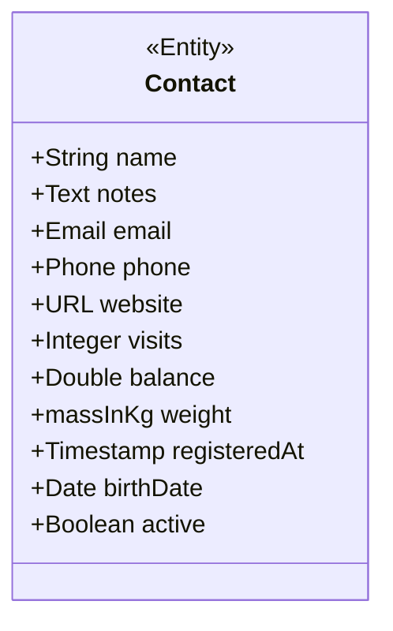

## Intent

Give every attribute a named type from one library, so limits and formats are decided once per project. The library is a `types` package (strings, numerics, boolean, date and time types) plus a `measures` package of physical units.

## Practice

### Use library types, not inline parameters

- The platform's primitives are string, numeric, boolean, date, time, timestamp, binary and enumeration types. A string type requires `maxLength` (and may have a regular expression); a numeric type requires `precision` and `scale`; time and timestamp types carry a base unit; a binary type has a size limit and MIME types ([type reference](../../agent-docs/model/esm_metamodel/type.md)). Password and XML types are not usable in a generated application.
- The model language itself ships a minimal set: `Boolean`, `Date`, `Time`, `Timestamp`, `Integer` (precision 9, scale 0), `Long` (precision 15, scale 0) and `String` (max size 4000) ([built-in libraries](../../agent-docs/model/jsl-language-notes.md)). The project type library below is project practice on top of those.
- Declare attributes with the library types only. Add domain types (a tax number with a pattern, a lower-case code, a coordinate) as named project additions in the same package.

### Typical library contents

The values below are what the projects settled on, not platform rules.

- Strings: `String` (255), `Text` (a longer limit; projects use 250, 1000, 2000 or 4000), `Email` (255, usually with a regular expression), `Phone` (20), `URL` (1024).
- Numerics: `Integer` (9, 0), `Long` (18, 0), `Double` (15, 4), `Float` (7, 4). Precision is the number of digits, scale the digits after the point.
- Others: `Boolean`, `Date`, `Timestamp` (base unit second), usually `Time`.
- Binary types are declared at the model root per use: documents, pictures, JSON or YAML uploads, each with its MIME types and size limit.
- Pick one `Text` limit for the project and keep it; the projects differ (250 in itracker, BHS, judo-partner; 2000 in SkillMatrix and AMS), which matters when copying attributes between models.

### Choose by meaning

`String` for names, codes, identifiers; `Text` for descriptions and notes; `Email`, `Phone`, `URL` for contact values (the validation travels with the type); `Integer` for counts, scores and flags that must be summed; `Date`, `Time`, `Timestamp` by business meaning (ParkHere uses all three). Strings longer than 255 render as multi-line text fields ([type-to-widget mapping](../../agent-docs/frontend/esm-to-ui-mappings/README.md)).

### Measures

The measures package holds about 25 to 28 measures (Mass, Length, Time, Temperature, Area, Volume and so on), each with units and conversion rates to a base unit. Almost no project uses them: of the 18 projects, only a custom measured type in ActionGroupTest (`massInKg`) appears on an attribute. The package is generated into every model whether or not it is used. See [[standard-type-and-measure-library]] for how a measured type works.

## Rationale

- One place decides lengths, precision and validation, so entities stay consistent.
- Regular expressions on `Email` and similar types validate input without code.
- Cost: the measures package adds clutter when unused, and changing a shared type changes every attribute that uses it, which can change database column sizes.
- Types are not interchangeable across models: do not assume `Text` has the same limit in a copied model.

## Example

A Contact entity uses `String` for the name, `Text` for notes, `Email`, `Phone` and `URL` for contact values, `Integer` for a visit counter, `Double` for a balance, a measured type `massInKg` for a weight, `Timestamp` for the registration time, `Date` for a birth date and `Boolean` for an active flag. Every attribute type comes from the one types package. Names are neutral stand-ins.

## When to avoid

- A one-off value with a unique limit: define a named domain type rather than an inline exception.
- Amounts with a business-defined scale (money): the library `Double` has scale 4 and `Float` scale 4; define a named numeric type with the precision and scale the business needs.
- Boolean semantics where sums are needed: MJSZ used Integer 0/1 flags for that, a deliberate exception.

## Related

- [[standard-type-and-measure-library]] — the blueprint with measured types and the generated pages
- [[naming-conventions]] — naming of types and members
- [[category-enum-pattern]] — enumerations as the other kind of attribute type

## Structure diagram

<!-- mermaid:generated fragment=standard-type-library cli=1.1.0.20261108_202643_d9769d90_develop -->

<!-- /mermaid:generated -->
