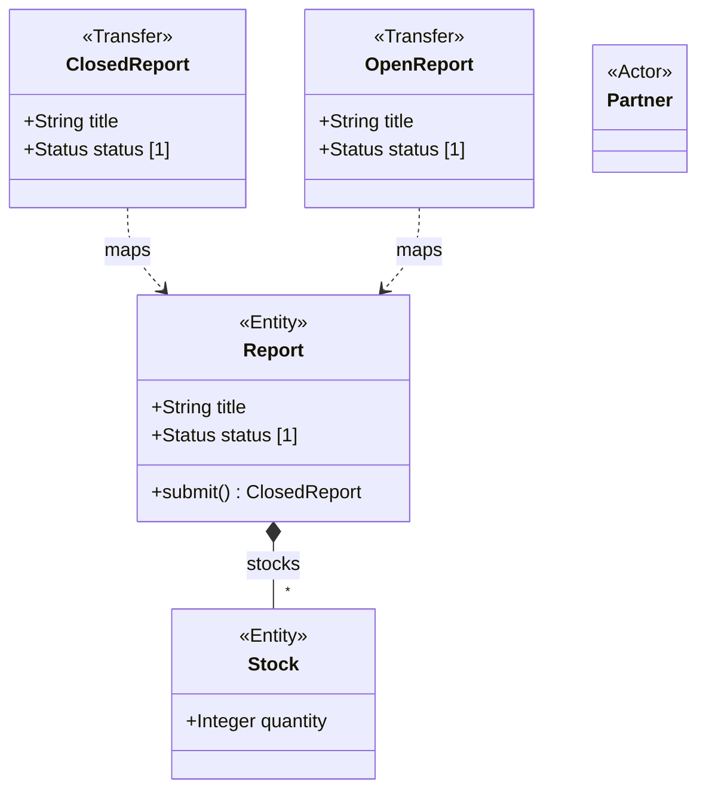

## Intent

An entity has a lifecycle with a clear boundary between "still being worked on" and "final". Instead of one list that shows every row with the status as a column, give each state group its own entry point and its own transfer object, with permissions to match.

## Practice

### One entity, one transfer object and one access per state group

- The entity has a status enumeration attribute ([[enum-state-machine]]).
- Two (or more) transfer objects map the same entity. The open one is updateable, may allow create, update and delete on owned children and carries the operations valid in that state. The closed one has the CRUD flags off and no operations.
- The actor holds one Access per state group. Each Access targets its own transfer object and has a derived getter expression that filters by state: the open one keeps rows whose status equals the open value, the closed one rows whose status differs. The getter is a JQL filter over the entity ([[derived-access-filtering]]).
- The Access carries the permissions for that entry point; the transfer object's flags say what the type allows ([accesspoint reference](../../agent-docs/model/esm_metamodel/accesspoint.md)). Set both consistently, because a permission needs both to be on.
- Each Access that should show up in the menu needs its own MenuItemAccess; one per partition ([pairing rule](../../agent-docs/model/esm_metamodel/accesspoint.md)). Each mapped transfer object used in the UI needs its generated View, Form and Table pages.

### Moving a row between partitions

An operation on the open type changes the status and returns the closed transfer type. The UI's post-call navigation then lands on the destination partition; see [[operation-return-type-navigation]]. The operation is a custom implementation in project code and must write the status itself.

### The partition is a view, not a guard

The getter expression only decides which rows each list shows. It does not stop an API client from calling an update on a closed row through another route if the entity or another access allows it. Keep update and delete off on the closed transfer object and check the status inside operations or interceptors that change data.

## Rationale

- Editable and read-only states look and behave differently, so the UI cannot offer an edit on a finalized record.
- A different set of derived attributes and operations per state, with no conditional logic in the UI.
- Cost: more transfer objects to maintain, the status filters are written twice (one the complement of the other, which must stay complementary when states are added), and the transitions must return the right transfer type.

## Example

A Report entity has a `status` (Pending, Submitted), a title and owned stock lines. OpenReport maps Report and is updateable; ClosedReport maps it read-only. A Partner actor has an `openReports` access that keeps pending reports and a `closedReports` access that keeps the rest. Report has an operation `submit` that returns a ClosedReport, so a submitted report moves from one list to the other. The original (Viterra) used four statuses (pending, submitted, review, accepted) with the open partition equal to pending. Names are neutral stand-ins.

## When to avoid

- Only a read-only flag differs: one transfer object with a derived boolean and `enabledBy` on actions is enough.
- Every state needs its own treatment: partition per group of states, not per state.
- Row visibility differs per actor rather than per state: use [[actor-based-transfer-projection]].

## Related

- [[enum-state-machine]] — the status enumeration
- [[derived-access-filtering]] — the state filter on each Access
- [[operation-return-type-navigation]] — landing on the destination partition after a transition
- [[actor-based-transfer-projection]] — partition by actor instead of by state

## Structure diagram

<!-- mermaid:generated fragment=state-based-transfer-partitioning cli=1.1.0.20261108_202643_d9769d90_develop -->

<!-- /mermaid:generated -->
