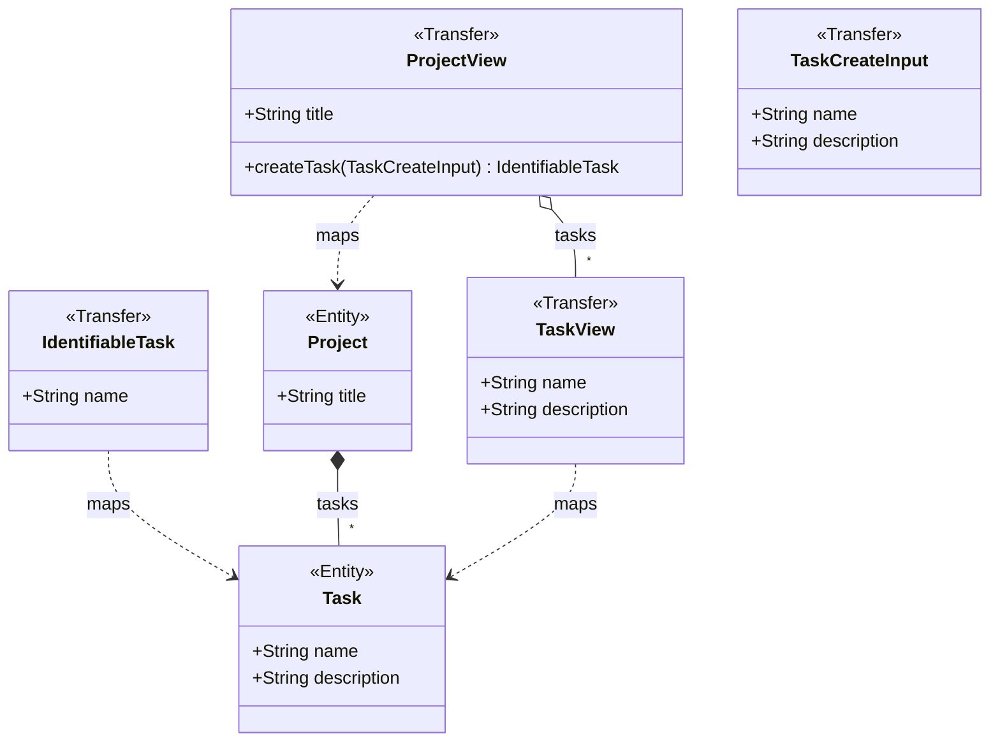

## Intent

A custom create operation on a parent (`A.createB(input)`) should return a thin mapped projection of the new B, enough to carry its identifier, and let the frontend redirect to the caller's own relation view of B. This avoids a full second projection of B just for the landing page, and keeps the standalone view of B from becoming the canonical surface.

## Practice

For a relation from A to B (list or single) where create-B is a custom operation:

| Decision | Choice |
|---|---|
| Return type | a mapped transfer object of B with one attribute; it carries the identifier |
| Default navigation (standalone view of the returned type) | overridden by a frontend `OperationFlowManager` |
| Landing | the caller's relation view of B, filtered or selected to the new row |
| Full B transfer object | stays for the relation list and detail; not the operation's return type |

Why a separate thin transfer object rather than the full one:

- A mapped transfer object needs at least one mapped attribute (project reading; the agent-docs do not state it, *verify*), so the thin type keeps one attribute that is never shown. Document it so nobody renders it later.
- The standalone view of the full B type stays unused: nothing returns it, so nothing links into it (one representation per concept, see [[relation-driven-crud-with-custom-input]]).
- The operation contract does not change when the full B projection gains or loses fields.
- The result is small and holds only the identifier.
- If the result ever feeds a refresh or edit form, only the identifier is meaningful; there is no half-filled edit surface.
- Make the thin type read-only (not createable, updateable or deleteable).

The operation takes an unmapped input transfer object when its shape differs from B ([[unmapped-transfer-dto]]). The body is custom project code; interceptors never run around a custom operation, so required checks belong in the body.

On the frontend, a flow manager registered for this operation maps the result to an actor, an access and a filter on the new identifier. Its interface is in the [action hooks guide](../../agent-docs/frontend/hooks/action-hooks.md); recipes in [[operation-flow-manager-redirect]]. Project practice, the shape of the returned object: actor name, access name that resolves the parent, and a filter on the identifier of the result. If the relation list lives deeper than the access, use whichever navigation the flow manager contract supports (id-based detail or filtered list).

### When not to use it

| Case | Use instead |
|---|---|
| The operation returns another entity (the parent or a sibling) | The default navigation for the returned type fits ([[operation-return-type-navigation]]). |
| The result needs inline editing on the caller page | The full B type with output behaviours ([[operation-output-with-behaviors]]). |
| A multi-step flow where the next step depends on computed state | A redirect transfer object ([[operation-flow-redirect-pattern]]). |
| The create is fire-and-forget and the user stays on the list | No return value; the list refreshes. |

A void return refreshes the list, but the user must find the new row; the thin result enables landing directly on it.

## Rationale

- One canonical view for B, one source for its projection, an operation contract independent of that projection.
- Cost: one more transfer object, a flow manager registration per such operation, and an unused attribute that needs a comment.
- Prefer it when a create-on-relation operation exists, the parent has a canonical relation list and detail for B, and you do not want the standalone view reachable.

## Example

A project view has a tasks relation to a mapped task view (the canonical list and detail). The project view's `createTask` operation takes an unmapped task create input (a name and a description) and returns a thin read-only task reference with only the name. The frontend flow manager opens the project's tasks list filtered to the new task. The diagram shows the shape. Observed in compsych-letter-demo.

## When to avoid

- See the table above: another entity returned, inline edit, multi-step flows, fire-and-forget creates.
- Prototypes with no frontend flow manager: without the redirect the thin result lands on the standalone view and shows only the dummy attribute.

## Related

- [[relation-driven-crud-with-custom-input]] — shape-divergent create, return-type matrix, anti-patterns
- [[operation-flow-manager-redirect]] — flow manager registration and recipes
- [[operation-return-type-navigation]] — the default navigation this overrides
- [[operation-flow-redirect-pattern]] — redirect-object workflow alternative
- [[actor-based-transfer-projection]] — one transfer object per relation target
- [[managed-actor-admin-pattern]] — admin surface with a custom operation and redirect

## Structure diagram

<!-- mermaid:generated fragment=thin-identifiable-result-for-parent-relation-create cli=1.1.0.20261108_202643_d9769d90_develop -->

<!-- /mermaid:generated -->
