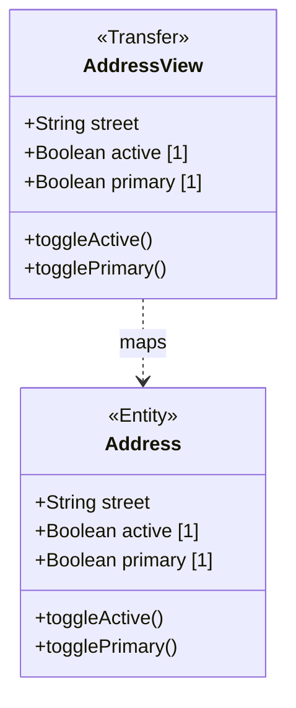

## Intent

A boolean flag such as `active` or `primary` often has rules attached: only one address may be primary, deactivating a parent deactivates its children. Put the change in a dedicated operation so those rules run every time, instead of letting clients write the attribute directly.

## Practice

### One instance operation per flag

- The entity has a boolean attribute and an instance operation that flips it: `toggle` plus the flag name (`toggleActive`, `togglePrimary`, `toggleBilling`). MLSZKSZPlatform used `activateToggle` and `changeVisibility`; one naming scheme per model is enough.
- The operation holds the side effects: unsetting the other primary item, updating a parent reference, cascading to children.
- The operation writes data, so it must be `stateful`; the DAO rejects writes in a stateless operation ([operation reference](../../agent-docs/model/esm_metamodel/operation.md)). The body is project code (a custom implementation, see [[custom-implementation-placeholder]]) or an operation script ([operation scripts](../../agent-docs/model/jcl-operation-scripts.md)).

### Expose it through a mapped operation

The actor's transfer object maps the entity and carries an operation of type `MAPPED` bound to the entity operation, with no body of its own. See [[mapped-operation-delegation]]. Expose it only on the transfer objects of actors who may call it. The generated UI shows it as a button on the view page or table row.

### Keep the flag itself read-only

Map the flag on the transfer object as a read-only member (do not make the transfer object updateable for it), or leave the flag out of editable forms. Otherwise the generated edit form lets users change it directly and bypass the rules. The platform does not forbid that: this is a modelling decision, and a transfer object that is updateable for other fields will include every mapped writable field.

### The operation is the only guard

Hiding a button is not protection. Interceptors do not fire for mapped, custom or script operations ([interceptors](../../agent-docs/backend/interceptors.md)), so check permissions and state inside the entity operation itself.

## Rationale

- Business rules for flag changes sit in one place and cannot be skipped by a form edit.
- Cost: one operation per flag, a mapped declaration per transfer object, and a server round trip for a simple flip. RackInspect has about 30 toggle operations over 16 entities.
- A flag without side effects does not need this; see [[soft-delete-active-flag]] for plain flag updates.

## Example

An Address entity has `street`, a required `active` (default true) and a required `primary` (default false), plus the operations `toggleActive` and `togglePrimary`. The AddressView transfer object maps the entity and carries two MAPPED operations bound to them. `togglePrimary` clears the primary flag on the other addresses of the same owner before setting it. The original projects (RackInspect: five toggles on addresses, two on bank accounts) used the same shape. Names are neutral stand-ins.

## When to avoid

- The flag has no rules attached: update it as an ordinary attribute.
- Several flags change together or the state is richer than on/off: use a status enumeration and a transition operation ([[enum-state-machine]]).
- Very simple models where every extra operation is more than the rule is worth.

## Related

- [[soft-delete-active-flag]] — the active flag this operation often changes
- [[primary-selection-pattern]] — mutual exclusivity of a primary item
- [[mapped-operation-delegation]] — exposing the operation on a transfer object
- [[custom-implementation-placeholder]] — where the operation body lives
- [[enum-state-machine]] — alternative for richer lifecycles

## Structure diagram

<!-- mermaid:generated fragment=toggle-operation-pattern cli=1.1.0.20261108_202643_d9769d90_develop -->

<!-- /mermaid:generated -->
