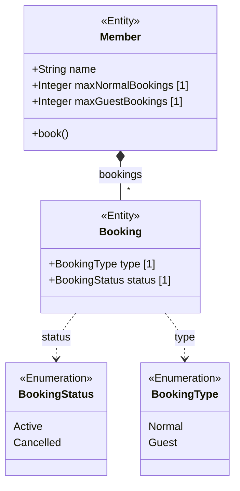

## Intent

Limit how many active items of a given kind a user may hold (reservations, bookings, open requests), with limits that administrators can raise or lower per user. The limit is data on the user; the enforcement is code in the creating operation.

## Practice

### Quota attributes on the user entity

- One required integer attribute per limited kind, each with a default expression that gives the standard limit (for example 5 normal, 5 guest, 2 long-term). Defaults apply on creation only; changing a default later does not touch existing users ([default value conventions](./default-value-patterns.md)).
- Each quota corresponds to a member of a category enumeration on the limited entity (`type`: Normal, Guest), so the operation can map a type to its quota attribute ([[category-enum-pattern]]).
- The quota attributes are exposed on the admin transfer object as editable and on the user's own transfer object as read-only (or not at all). That is the per-user override.
- The limited item has a status (Active, Cancelled) so "active" can be counted.

### Enforcement is a custom operation, not model validation

The platform has no declarative quota or constraint. The operation that creates the item is a custom implementation in project code and does:

1. Count the user's items with active status and the same type (a JQL collection filter and `!count()` over the user's relation, or the same through the DAO).
2. Compare with the quota attribute for that type.
3. If the count has reached the quota, refuse.

The refusal is a business failure. Model it as a fault attached to the operation, with the error code as the quota reason ([[error-code-enum-pattern]]). A modeled fault is a transfer object listed in the operation's faults; the custom operation must declare it or the generated interface has no matching `throws` clause, and it reaches the client as HTTP 422 with an `X-Fault` header ([modeled faults](../../agent-docs/backend/error-handling-guide.md)). A validation exception with a code prefix is a lighter alternative when the UI needs no typed handling.

### Close every creation path

Every operation or standard create that can add the item must run the check, including the generic create that the platform generates when the access allows creation. Either turn off create on the item's transfer object and allow creation only through the checked operation, or enforce the check in an interceptor on the create call ([interceptors](../../agent-docs/backend/interceptors.md)). Interceptors do not fire for custom operations, so an interceptor and a custom operation do not cover each other.

### Races

Count-then-create is not atomic. Two concurrent calls can both pass the check and exceed the quota by one. If the limit is hard, serialize creation per user in project code.

## Rationale

- Per-user limits are plain data that admins edit, with sensible defaults.
- The logic is simple and extends by adding an attribute and an enumeration member.
- Cost: no model-level validation, so one forgotten creation path bypasses the limit, and the count query runs on each creation.
- Types limited by time rather than count (one project's quick reservations) need a different check.

## Example

A Member entity has two required integer attributes, `maxNormalBookings` (default 5) and `maxGuestBookings` (default 2), and owns `bookings`. A Booking has a `type` (Normal, Guest) and a `status` (Active, Cancelled). The `book` operation on Member counts the active bookings of the requested type, compares with the matching quota and refuses when the quota is reached. The original model had three quotas and reported the failure as a typed `TOO_MANY_BOOKINGS` error. Names are neutral stand-ins.

## When to avoid

- One global limit for all users: store it in a configuration singleton ([[singleton-entity]]).
- Limits on stored totals or sizes rather than counts: use a different check.
- The limit must hold under heavy concurrency without project-level locking.

## Related

- [[category-enum-pattern]] — quota types correspond to category enumeration members
- [[error-code-enum-pattern]] — the quota failure as a typed error code
- [[default-value-patterns]] — defaults for the quota attributes
- [[multi-role-single-entity]] — quotas on the same user entity as role flags
- [[singleton-entity]] — global limit alternative

## Structure diagram

<!-- mermaid:generated fragment=token-based-quota-limit cli=1.1.0.20261108_202643_d9769d90_develop -->

<!-- /mermaid:generated -->
