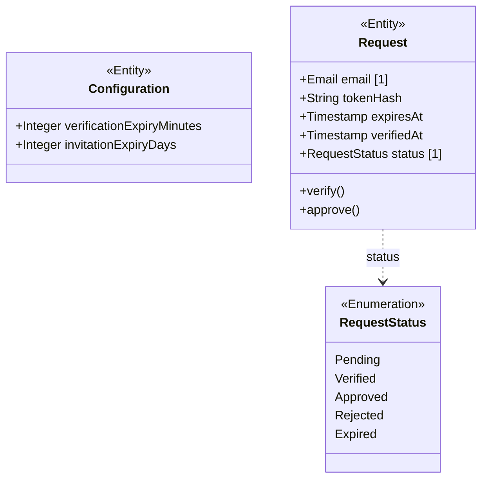

## Intent

Let an external person prove control of an e-mail address before they get access. The system sends a one-time token; clicking the link verifies the request; an administrator then approves or rejects it. Tokens expire.

## Practice

### Attributes and status

- A token attribute (stored as a hash, see below), an expiry timestamp (`verificationExpiresAt`, `expiresAt`) and a `verifiedAt` timestamp.
- A status enumeration with at least Pending, Verified, Expired and the administrator outcomes Approved and Rejected ([[enum-state-machine]]). Pending moves to Verified on a valid token, then to Approved or Rejected by an administrator, or to Expired when the time has passed.
- Expiry durations (`invitationExpiryDays`, `verificationExpiryMinutes`) are settings, kept in a configuration singleton ([[singleton-entity]]), not in each row.

### Operations are project code

The platform has no token or verification feature. These steps are custom operations ([[custom-implementation-placeholder]]):

- Submit or create: generate the token, set the expiry from the configuration, send the e-mail.
- Verify: find the row by token, refuse if the expiry has passed or it is not pending, set the status to Verified and `verifiedAt`.
- Approve and reject: administrator operations after verification.

The operations write data, so they must be `stateful` ([operation reference](../../agent-docs/model/esm_metamodel/operation.md)). A refusal (expired, wrong status, unknown token) is a business failure and can be a modeled fault attached to the operation ([modeled faults](../../agent-docs/backend/error-handling-guide.md)).

### Public entry points need an anonymous actor

The person verifying has no account. The submit and verify operations are exposed to an actor that is marked anonymous (an unauthenticated guest actor, see [accesspoint reference](../../agent-docs/model/esm_metamodel/accesspoint.md)). Because that actor is open to anyone, the operations must be written defensively: do not reveal whether a token exists, and rate-limit in project code if needed.

### Token handling (a convention)

- Generate the token with a cryptographically secure random source and make it long; see [[api-key-generation]].
- Store only a hash of the token and send the plain token once, as the invitation blueprint does ([[invitation-with-recipients]]). The source project named the attribute `verificationToken` (or `invitationToken`); the diagram names it `tokenHash` because only the hash is stored.
- Mark the token used only after the follow-up step (registration) has succeeded, so a failure does not burn it.
- Expired rows do not clean themselves; the Expired status is set when the token is presented late, or by a scheduled job in project code. Delete or archive old rows in project code.

## Rationale

- Proves e-mail ownership without storing a password.
- Expiry is configurable, and the state progression is explicit and testable.
- Cost: needs an e-mail integration, token handling code and cleanup of expired rows. The tokens and expiry rely entirely on project code; nothing in the model enforces them.

## Example

A Request entity has a required `email`, a `tokenHash`, `expiresAt`, `verifiedAt` and a `status` (Pending, Verified, Approved, Rejected, Expired). A Configuration entity holds `verificationExpiryMinutes` and `invitationExpiryDays`. Operations `verify` and `approve` on Request are custom implementations. The original project used three entities this way (registration request, invitation recipient, user invitation request) with a registration operation that generated the token and a verify operation that checked it. In the source model the attribute is named `verificationToken`, not `tokenHash`; the names in this example are neutral stand-ins.

## When to avoid

- Users already log in through the platform's authentication: no verification step is needed.
- A one-time code entered by the user rather than a link: see [[two-phase-registration]] and the code-based authentication blueprint.
- No e-mail channel available.

## Related

- [[enum-state-machine]] — status lifecycle for verification entities
- [[custom-implementation-placeholder]] — token generation and validation in project code
- [[singleton-entity]] — configuration singleton that stores the expiry settings
- [[api-key-generation]] — generating the random token
- [[invitation-with-recipients]] — the same token flow with hashed tokens as a blueprint
- [[two-phase-registration]] — registration in two steps

## Structure diagram

<!-- mermaid:generated fragment=token-based-verification-workflow cli=1.1.0.20261108_202643_d9769d90_develop -->

<!-- /mermaid:generated -->
