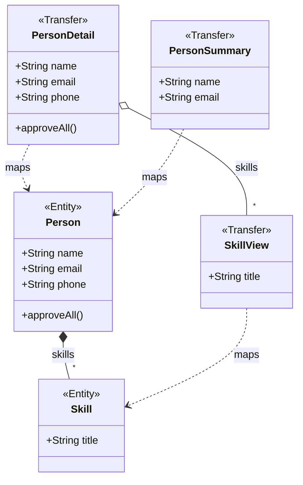

## Intent

A profile-style base view and richer role-specific views of the same entity are a common need: the base transfer shows a few attributes, the extended ones add relations and operations. Older projects expressed this as a transfer object that "extends" another one. The platform does not support that, so this practice states what to model instead.

## Practice

### Generalization is an entity-type feature

The metamodel gives every class a list of generalizations, but the agent-docs state that inheritance between transfer object types is not supported ([model development guide](../../agent-docs/model/model-development.md), pattern "Polymorphism with Inheritance"). Generalization works between entity types only. A transfer object type does not extend another transfer object type. (The model CLI schema for a transfer object type lists a `superTypes` field, but the agent-docs say not to rely on it.) Treat any model that appears to extend one transfer object from another as a project convention or a modelling mistake, and do not copy it.

### Declare each purpose-specific transfer object on its own

Map every transfer object to the same entity and give each one the attributes, relations and operations it needs:

- a base view (for example a profile summary) with the common attributes, each bound to the entity attribute;
- an extended view mapped to the same entity that lists those common attributes again and adds the relations and bound operations only this view needs;
- one such transfer object per role or screen, as described in [[transfer-object-multiplicity]] and [[actor-based-transfer-projection]].

The repeated attributes are cheap: each is a mapped binding to the one entity attribute, so the stored data, validation and defaults stay in one place. The duplication is in the transfer declarations only.

### Put real sharing on the entity

If the shared structure is a real "is-a" hierarchy of data, model it as entity generalization (see [[generalization-base-entity]]) and let each transfer object map the subtype or the base entity. Shared attributes then live once on the entity, and only the projections are repeated.

## Rationale

- Declaring the transfer objects separately matches what the platform supports, so the model validates and the generated services and pages exist for each transfer object.
- Each transfer object stays a complete, readable contract for one consumer. A change to the base view does not silently change every extended view; the price is that a new common attribute must be added to each view that should show it.
- Keeping the shared data on the entity keeps the duplication small and mechanical.
- Project practice: the source projects described a base transfer extended by role-specific transfers. The agent-docs do not confirm that this is valid platform modelling, so this entry records the supported alternative.

## Example

A Person entity has name, email and phone, a composed collection of Skill, and an operation `approveAll`. PersonSummary maps Person and exposes name and email only. PersonDetail maps Person too, lists name, email and phone again, adds the mapped `skills` relation to a SkillView transfer object and the mapped operation `approveAll`. There is no link between PersonSummary and PersonDetail other than the entity they both map.

## When to avoid

- A real data hierarchy exists: use entity generalization and map the subtypes.
- One transfer object serves all consumers: no second declaration is needed.
- The views differ so much that they share almost no attributes: they are simply separate transfer objects.

## Related

- [[transfer-object-multiplicity]] — several transfer objects over one entity
- [[actor-based-transfer-projection]] — role-specific projections
- [[generalization-base-entity]] — generalization on entity types, which the platform does support

## Structure diagram

<!-- mermaid:generated fragment=transfer-generalization cli=1.1.0.20261108_202643_d9769d90_develop -->

<!-- /mermaid:generated -->
