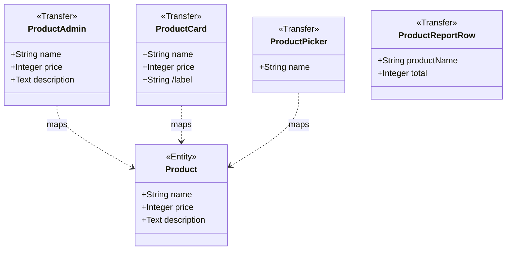

## Intent

One entity usually has more than one audience: an editor that needs every attribute, a dropdown that needs a name, a list that needs a few derived columns, a report that needs a flat row. Give each purpose its own transfer object instead of one large transfer object for everybody.

## Practice

### Several mapped transfer objects over one entity

The platform lets any number of transfer object types map the same entity. The agent-docs describe this as the purpose-built transfer object pattern: a small list transfer object for tables and a full detail transfer object for forms, and the table's access should target the list one to avoid over-fetching ([model development guide](../../agent-docs/model/model-development.md), "Purpose-Built Transfer Objects"). Typical kinds:

- **Full editor**: all attributes the role may edit, with create, update and delete allowed as the role needs.
- **Summary or read-only card**: a subset of mapped attributes plus derived ones, with create, update and delete switched off.
- **Picker**: only the identifying attribute (name) for selection lists.
- **Report row**: an unmapped transfer object whose attributes are all transient; see [[unmapped-transfer-dto]].

### Each transfer object is declared separately

Do not model the kinds as one transfer object extending another. The agent-docs state that inheritance between transfer object types is not supported, so each view lists its own attributes (see [[transfer-generalization]]). A mapped attribute binds to the entity attribute; a derived attribute carries its own getter expression, evaluated on the mapped entity (see [[derived-attribute-flattening]]).

### Choose the transfer object per access

An actor reaches an entity through an access whose target is a transfer object type. Pick the narrowest transfer object for that access: the role's editor for its own records, the card for a read-only list, the picker for the range of a relation. Different actors may share one transfer object when their needs match. How access rules are written is described in [[actor-based-transfer-projection]].

### Mapped transfer objects have a generated CRUD surface, unmapped ones do not

The data-access guide says the generated DAO has full CRUD only for mapped, non-abstract transfer object types, and the model reference shows the CRUD page only for mapped ones. Unmapped transfer objects get no create, read or delete by identifier. Use mapped transfer objects for anything a user lists or edits and unmapped ones only for operation parameters and result rows.

## Rationale

- Each consumer receives only the data it needs, which keeps payloads small and limits what a role can read.
- Create, update and delete permissions can differ per transfer object while the entity stays the single source of the stored data.
- Practice note (not a platform rule): in the source projects the ratio was often 2:1 to 4:1 transfer objects per entity (for example about 44 transfer objects over 11 entities in one project), and some entities had five or more views. Names state the purpose or the role (`...Admin`, `...Picker`, `...ForPartner`), because several transfer objects for one entity are easy to confuse.
- Cost: every entity change must be checked against all views that bind to it, and a shared attribute must be repeated in each view that needs it.

## Example

A Product entity has name, price and description. ProductAdmin maps all three and may create, update and delete. ProductCard maps name and price, adds a derived label, and is read-only. ProductPicker maps only name and is read-only. ProductReportRow is unmapped and holds a transient product name and total for a report. The first three all map Product; the fourth maps nothing and is filled by an operation.

## When to avoid

- One consumer only: a single transfer object is enough.
- The views differ by one or two attributes and the role split is not needed: use one transfer object and hide the extras in the UI.
- No team capacity to keep many views in sync: fewer, broader transfer objects are easier to maintain.

## Related

- [[actor-based-transfer-projection]] — transfer objects reached by an actor access
- [[derived-attribute-flattening]] — derived attributes on summary views
- [[unmapped-transfer-dto]] — transient report rows and parameter containers
- [[transfer-generalization]] — why views are declared separately

## Structure diagram

