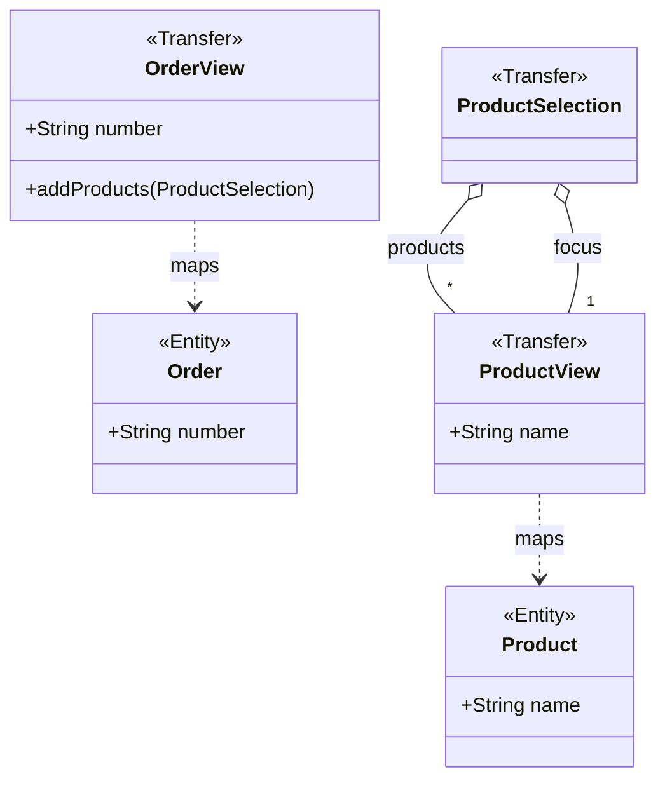

## Intent

An operation sometimes needs more than flat values: a chosen set of existing records, or a few nested input objects. Carry them in a transient relation on an unmapped parameter transfer object, so the operation signature stays a single input object and nothing is stored for the input itself.

## Practice

### Declare the relation as TRANSIENT on an unmapped transfer object

The metamodel allows a relation member of kind `TRANSIENT` on any transfer object type, mapped or unmapped; entities cannot have one, and a transient relation is not persisted ([structure reference](../../agent-docs/model/esm_metamodel/structure.md), relation member constraints). Use an unmapped transfer object as the operation's input type and put the transient relations on it:

- the relation target is another transfer object type (here a view of the entity whose records are chosen), never the entity itself;
- cardinality says whether one choice or a collection is expected;
- the relation kind is usually aggregation, a reference without ownership.

### Control what the user may pick and what is preselected

For a transient relation the model offers a default expression (a preselected value) and a range (the set of selectable targets, either any instance of the target or a derived expression). The CLI schema lists both fields as available for transient relations on a transfer object, and the generated UI uses the range for the picker. A derived range lets the input offer only valid candidates, for example active users of one role.

### Read the input in the operation

The operation receives the parameter transfer object as `input`. The JCL reference states that `input` is immutable unless declared mutable, and that `mutable` is a unary prefix operator ([JCL operation scripts](../../agent-docs/model/jcl-operation-scripts.md)). The agent-docs do not describe what happens when a transient reference is read from `input` and linked to a stored record; test that on the target version before relying on it. Source projects used `mutable input.<relation>` in the body for this; treat it as project practice.

## Rationale

- The signature stays simple: one input object carries all parts, instead of many scalar parameters.
- The transient data cannot be queried or reused later, which is right for a one-shot input and avoids cleanup.
- The range and default expressions put picker behaviour in the model rather than in client code.
- Limit: tabular reference field columns on an unmapped input transfer object that reference attributes of another transfer object break the UI build (see the frontend pitfalls guide), so keep the picker to the reference field itself and avoid extra columns on the input page.

## Example

An Order view has an operation `addProducts`. Its input is the unmapped transfer object ProductSelection. ProductSelection has a transient relation `products` to ProductView with cardinality zero or more, and a transient relation `focus` to ProductView with exactly one. The caller fills the input from a picker; the body of `addProducts` reads `input.products` and `input.focus` and links them to the order. After the call nothing of ProductSelection remains.

## When to avoid

- The input is flat scalar data: use plain transient attributes on the parameter object, see [[unmapped-transfer-dto]].
- The user must keep editing the collection across several calls: that data needs an entity.
- The chosen records are already part of the mapped transfer object the operation is bound to: use that relation directly.

## Related

- [[unmapped-transfer-dto]] — the parameter container that holds the transient relation
- [[factory-operation-with-prepopulation]] — input objects with defaults for create operations

## Structure diagram

<!-- mermaid:generated fragment=transient-relation-parameter cli=1.1.0.20261108_202643_d9769d90_develop -->

<!-- /mermaid:generated -->
