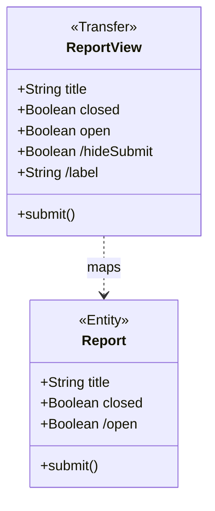

## Intent

The UI model decides visibility, enablement and confirmation only from boolean data members. When the rule depends on entity state or on the current user, expose the result as an attribute of the transfer object the page uses, so the page carries no business logic of its own.

## Practice

### The control must be a boolean on the same transfer object

The UI authoring guide states that `hiddenBy`, `enabledBy`, `requiredBy` and `confirmationCondition` must reference a boolean data member of the transfer object that owns the element; cross-object references are not possible ([UI authoring guide](../../agent-docs/model/ui-authoring-guide.md), invariants and section on `hiddenBy` / `enabledBy` / `requiredBy`). The effect is: `hiddenBy` true hides the element, `enabledBy` true enables it (otherwise disabled), `requiredBy` true makes a data field required. `confirmationType` on an operation form is `NONE`, `CONDITIONAL` (the condition member decides) or `MANDATORY`. So a state computed elsewhere must first be exposed on this transfer object.

### Derive the flag, do not store it

Add the flag to the transfer object as a derived attribute with a getter expression evaluated on the mapped entity, for example "not closed" or a status comparison. Derived attributes are read-only for clients and need no entity field ([structure reference](../../agent-docs/model/esm_metamodel/structure.md): derived members are allowed on any class). Typical members:

- an editability flag that enables the fields of a form;
- a hide or show flag for an action button, per lifecycle state;
- a role flag read from the current user, used for menu items and buttons (see [[conditional-visibility-getter]]);
- a computed display label.

Name flags positively or negatively to match the binding: `hiddenBy` wants a flag that is true when the element is hidden, so a negated twin (`isNotAdmin` beside `isAdmin`) is common.

### Use the flag for conditional confirmation

An operation form with confirmation `CONDITIONAL` points `confirmationCondition` at a boolean on the same transfer object, for instance "has dependent records". This mirrors the guard of the operation itself, see [[guard-clause-delete]].

### Menu items read the principal

On menu items, `hiddenBy` references a boolean of the actor's principal transfer object, usually a derived permission flag (UI authoring guide, section 9). See [[actor-based-transfer-projection]] for the actor side.

### The flag is presentation, not security

An API client can ignore the flag. The operation body or an interceptor must still reject invalid calls. Values that cannot be written as a model expression can be computed in backend code and exposed as a transient attribute without binding, the escape hatch the interceptor guide describes; this is a project-code option, not required by the pattern.

## Rationale

- The UI behaviour follows the model: one derived expression serves every page that shows the transfer object.
- Different actors can have different flags on their own transfer objects over the same entity.
- Cost: the transfer object grows beyond its entity and every extra flag is another member to keep correct. Combine conditions inside the expression, because the UI model accepts one reference per element.
- Practice note: source projects used flags such as editable, `hide<Action>`, `isNot...`, permission booleans per operation and `isOpen` / `isClosed` state flags. Names such as these are conventions, not platform names.

## Example

A Report entity has a title and a stored `closed` flag. The ReportView transfer object maps the entity and adds two derived members that exist nowhere on the entity: `hideSubmit`, true when the report is closed, and `label`, the display text. The page binds the submit button's `hiddenBy` to `hideSubmit`. A delete operation on the same view would use a derived "has dependants" flag as its confirmation condition.

## When to avoid

- The condition is constant: use a literal derived attribute, see [[literal-derived-attribute]].
- Several buttons share one enabling rule: group them, see [[action-group-conditional-enabling]].
- The rule needs data not reachable from the transfer object's entity: expose it through a relation first, or compute it in backend code.

## Related

- [[actor-based-transfer-projection]] — role-specific transfer objects that carry role flags
- [[conditional-visibility-getter]] — derived getter that drives visibility
- [[literal-derived-attribute]] — constant flags
- [[guard-clause-delete]] — the operation-side guard that conditional confirmation mirrors
- [[action-group-conditional-enabling]] — one flag for a group of buttons

## Structure diagram

