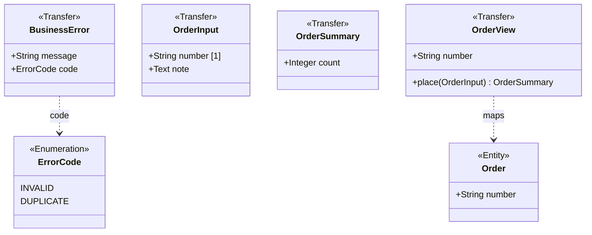

## Intent

Some data has no entity behind it: the input of an operation, the result of a calculation, an error payload, a flat report row. Model it as an unmapped transfer object, a standalone container that is never persisted and has no generated list or edit pages.

## Practice

### What an unmapped transfer object is

A transfer object type is mapped when it has a mapping to an entity type and unmapped when it has none. An unmapped one is a standalone data container, often the input of an operation ([model development guide](../../agent-docs/model/model-development.md), "Mapped vs. Unmapped Transfer Objects"). It cannot hold stored or mapped members: its attributes are `TRANSIENT` or `DERIVED`, and its relations `TRANSIENT` or `DERIVED` ([structure reference](../../agent-docs/model/esm_metamodel/structure.md), member constraints). Transient relations are covered in [[transient-relation-parameter]].

### Common roles

- **Operation input**: one container per operation or per family of operations, with required attributes for what the caller must supply and optional ones for the rest. Defaults can be set per attribute (see [[factory-operation-with-prepopulation]]).
- **Operation output**: the result type of an operation. An operation output must be a transfer object; the docs warn that pointing it at a bare data type silently fails, so a result that is a single binary or primitive needs a wrapper with one transient attribute ([advanced modeling patterns](../../agent-docs/model/advanced-modeling-patterns.md), wrapper transfer object for binary outputs).
- **Fault payload**: a modeled fault is a transfer object type attached to the operation as a fault. The operation must declare it, or custom code cannot throw it ([error handling guide](../../agent-docs/backend/error-handling-guide.md), Modeled Faults). A code enumeration plus a message is the usual payload, see [[error-code-enum-pattern]].
- **Identifier or data wrapper**: a single identifier, or a binary or structured payload.
- **Report row**: a flat object of transient attributes filled by an operation, one per result line.
- **Static operations holder and principal**: an unmapped transfer object can also carry static operations, or be an actor's principal (see the advanced modeling patterns and the access point reference).

### What the platform does and does not generate

The generated DAO has full CRUD only for mapped, non-abstract transfer objects; unmapped ones get only query accessors ([data access guide](../../agent-docs/backend/data-access-guide.md), "Which Types Get a Full DAO"). The UI model shows the CRUD page only for mapped transfer objects. Static parameterized query calls of the form `Type#query(...)` are only allowed on unmapped transfer objects (JCL scripts reference). Tabular reference field columns on an unmapped input transfer object that point at attributes of another transfer object break the UI build (frontend pitfalls guide).

### Project naming (convention, not platform)

Source projects named containers by role: an `Input` suffix for creation or operation input, `Update` for modification input, `Data` for read-only containers, `Output` for results, and a `BusinessError` fault type. Keep one convention per model.

## Rationale

- Operation signatures stay explicit and typed, with nothing persisted for transient input.
- Fault and result types are first-class model elements, so generated clients get typed errors and results.
- Cost: many small types accumulate in a large API; reuse one container across operations only when the fields really coincide (one project shared a single message container across four workflow operations).
- Because no CRUD is generated, anything users browse or edit must be a mapped transfer object instead, see [[transfer-object-multiplicity]].

## Example

An Order entity with a mapped OrderView. The operation `place` is declared on OrderView. Its input is the unmapped OrderInput (a required transient number and an optional transient note), its output is the unmapped OrderSummary (a transient count), and its declared fault is the unmapped BusinessError (a message and an ErrorCode enumeration with INVALID and DUPLICATE). None of the three is stored or gets a page of its own.

## When to avoid

- The data should be listed, edited or deleted by users: use a mapped transfer object.
- An existing mapped transfer object already carries the values: pass it instead of a copy.
- A single scalar input: a plain operation parameter attribute on the operation's input may be enough.

## Related

- [[transient-relation-parameter]] — transient relations inside an input container
- [[actor-based-transfer-projection]] — mapped, role-specific counterpart
- [[error-code-enum-pattern]] — fault payload with an error code enumeration
- [[factory-operation-with-prepopulation]] — input containers with defaults
- [[transfer-object-multiplicity]] — the mapped views that do have CRUD

## Structure diagram

<!-- mermaid:generated fragment=unmapped-transfer-dto cli=1.1.0.20261108_202643_d9769d90_develop -->

<!-- /mermaid:generated -->
