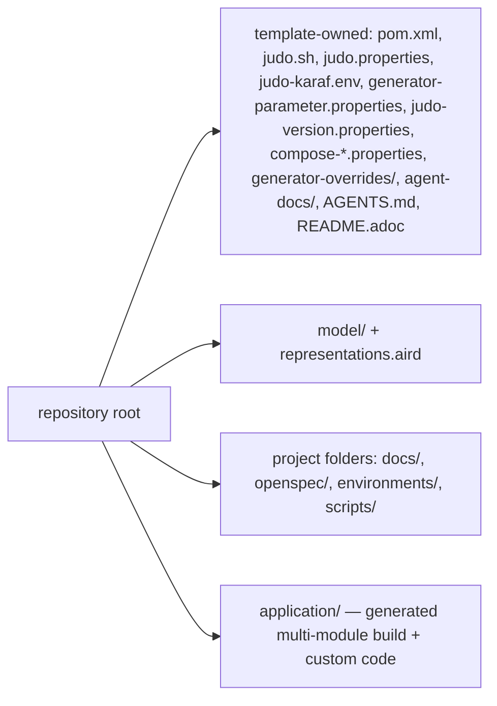

## Intent

A JUDO repository has two zones: the root, which holds the model, the build entry points and the runtime configuration, and `application/`, the generated Maven multi-module project that is built and deployed. Keep the root small and predictable so people and AI assistants find the source of truth without scanning dozens of loose files.

## Practice

### Platform base: what the template puts at the root

The project template generates the root from its `-root` module: `pom.xml`, the build script `judo.sh`, `generator-parameter.properties`, `AGENTS.md` and `README.adoc` ([creating a new project](../../agent-docs/deployment/build-process.md#creating-a-new-project-from-the-esm-fullstack-template)). Next to them:

- `model/<app>.model` is the model location the template expects ([same section](../../agent-docs/deployment/build-process.md#creating-a-new-project-from-the-esm-fullstack-template)). Keep only the model there; derived overviews and diagrams go elsewhere.
- `judo.properties` (start options) and `judo-karaf.env` (runtime `JUDO_PLATFORM_*` variables) ([configuration methods](../../agent-docs/deployment/application-config.md#primary-method-judo-karafenv)).
- `judo-version.properties` pins the platform versions ([multi-repository development](../../agent-docs/deployment/build-process.md#multi-repository-development-platform-changes)).
- `generator-overrides/` is the override root for the project-root generator step; `application/generator-overrides/` is the one for the application modules ([fragment overrides](../../agent-docs/deployment/build-process.md#extending-generated-files-via-fragment-overrides)).
- `compose-dev.properties` and `compose-full.properties` select the two shipped Compose stacks ([shipped environments](../../agent-docs/deployment/production.md#shipped-docker-compose-environments)).
- `agent-docs/` holds the generated platform docs ([tooling guide](../../agent-docs/deployment/tooling-guide.md) uses root-relative `agent-docs/domain/` paths).
- `representations.aird` is the Designer diagram file that sits next to the model and is read by the diagram tooling ([tooling guide](../../agent-docs/deployment/tooling-guide.md)).

### Practice notes: a few named folders, nothing loose

Add project content at the root only as **folders with one purpose each**:

| Folder | Holds |
|---|---|
| `docs/` | Business and functional docs, user guides, ADRs (`docs/adr/`), plans, meeting notes |
| `openspec/` (or another spec tool folder) | Specs and change proposals |
| `environments/` | Per-environment deployment (one folder per target) |
| `scripts/` | Project utility scripts, grouped by topic |

Everything that compiles, is generated, or ships in an image belongs under `application/` (custom code, schema migrations, Docker Compose profiles, locale files).

### What to keep out of the root

- One-off design notes, session handoffs and pull-request texts: put them in `docs/` or in the spec change folder they belong to.
- Large binaries (PDF exports, demo data spreadsheets, recordings): `docs/` with an ignore rule, or outside the repository.
- Build leftovers (exit-code files, test log folders): add them to `.gitignore`.
- Stray runtime descriptors (an `OSGI-INF/` folder copied from a bundle) belong in the module that uses them.

## Rationale

- The template regenerates root files; a clean root makes it obvious which files are template-owned and which the team owns (and therefore which go in `.generator-ignore`).
- Agents and new developers read the root listing first. Fifty mixed files hide the four that matter: the model, the build script, the runtime config and `AGENTS.md`.
- Cost: you must decide a home for every new document instead of dropping it at the root.

## Example

- One repository has the template root only (`application/`, `model/`, the properties files, `generator-overrides/`, `representations.aird`); the cleanest observed baseline.
- Two projects: the template root plus `docs/`, `openspec/`, an environments folder and `scripts/`. Both also show leakage: HTML mockups, an `Untitled.md`, a CSV of test data, a migration shell script at the root.
- One project: the same folders plus design notes, a session handoff, a PR description, a PDF model overview, three spreadsheets, an `OSGI-INF/` folder and build leftovers at the root.

## When to avoid

- A monorepo that hosts several applications or a separate mobile client may need one extra top-level folder per client (one project keeps `ios/` at the root). Keep the same one-purpose-per-folder rule.

## Related

- [[structure-ai-assistant-docs-layout]] — where `AGENTS.md`, agent docs and specs go
- [[structure-environments-folder]] — the environments folder and the root config files
- [[structure-scripts-folder]] — the scripts folder
- [[structure-translation-sources]] — translation spreadsheets and glossaries
- [[generator-ignore-config-protection]] — which root files to protect from regeneration
