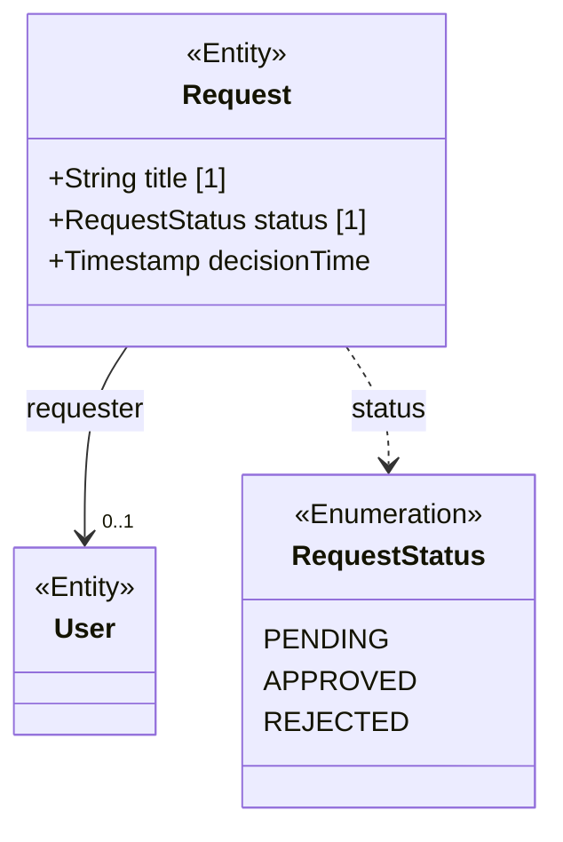

## Model shape

The shape has one request entity with two instance operations, one status enumeration with three values, one association to a user, and one input transfer object for the rejection reason.

- **Request** is the entity that needs a decision. It is not createable, updateable or deleteable through the generated actions; the status changes only through accept and reject. Its attributes are title (required string), status (required, enumeration), and decisionTime (timestamp).
- **RequestStatus** is the enumeration: PENDING, APPROVED and REJECTED. Values are stored as ordinals.
- **Request.accept** and **Request.reject** are instance operations with custom implementations. Reject takes a RejectInput.
- **RejectInput** is an unmapped transfer object with one text attribute, reason. It is only the input of reject.
- **RequestTO** is a transfer object that maps Request and exposes accept and reject to the UI. Its operations are shown only when the guard attributes allow them.
- **User** is the target of the optional association requester (0..1, association kind). Deleting the user does not remove the request.

Generated UI pages follow from the entity. The Request table and view pages stay for the admin dashboard. The accept and reject buttons use the generated operation UI. A guard attribute is a boolean derived attribute on the owner transfer object (for example "is pending"); the operation button is bound to it through its enabled or hidden condition, so only the pending status shows the buttons. The guard references only attributes of its own transfer object.

## Structure diagram

<!-- mermaid:generated fragment=accept-reject-operations cli=1.1.0.20261108_202643_d9769d90_develop -->

<!-- /mermaid:generated -->
