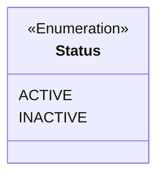

## Model shape

The shape has one enumeration with two members.

- **Status** is the enumeration. It has two members: ACTIVE (ordinal 1) and INACTIVE (ordinal 2). Values are stored as ordinals.
- An entity that needs an on or off lifecycle holds one required attribute of type Status. The enumeration does not own operations or relations.

The enumeration is used as the status attribute of the owning entity. The UI shows the status as a filter or a chip in tables; the generated enumeration input shows both values.

## Structure diagram

<!-- mermaid:generated fragment=active-inactive-status-enum cli=1.1.0.20261108_202643_d9769d90_develop -->

<!-- /mermaid:generated -->
