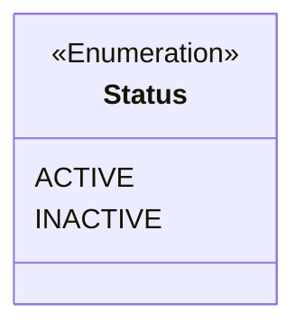

## Model shape

The shape has one enumeration with two members.

- **Status** is the enumeration. It has two members: ACTIVE (ordinal 1) and INACTIVE (ordinal 2). Each member carries a unique integer ordinal (0 to 9999 in JSL models) that stays fixed once data exists.
- An entity that needs an on or off lifecycle holds one required attribute of type Status. The enumeration does not own operations or relations.

The enumeration is used as the status attribute of the owning entity. The generated UI shows the status as a column and as an enumeration input listing both values; which filter or visual form the table uses is a UI model choice.

## Structure diagram

<!-- mermaid:generated fragment=active-inactive-status-enum cli=1.1.0.20261108_202643_d9769d90_develop -->

<!-- /mermaid:generated -->
