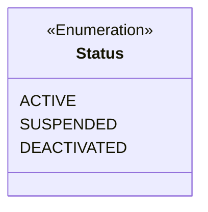

## Model shape

The shape has one enumeration with three members, used as the status attribute of an owning entity.

- **Status** is the enumeration. Its members are ACTIVE (ordinal 0), SUSPENDED (ordinal 1) and DEACTIVATED (ordinal 2). Values are stored as ordinals.
- An owning entity, such as a user or an organization, holds one required attribute of type Status.
- The enumeration has no operations and no relations. The transitions live on the owning entity.

Owning entities usually expose operations for each transition in the UI. The generated buttons show only the transitions allowed from the current status, using guard attributes on the transfer object.

## Structure diagram

<!-- mermaid:generated fragment=active-suspended-deactivated-status-enum cli=1.1.0.20261108_202643_d9769d90_develop -->

<!-- /mermaid:generated -->
