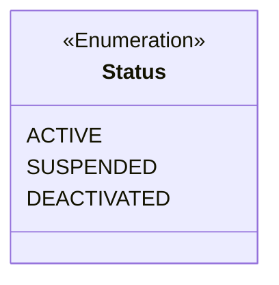

## Model shape

The shape has one enumeration with three members, used as the status attribute of an owning entity.

- **Status** is the enumeration. Its members are ACTIVE (ordinal 0), SUSPENDED (ordinal 1) and DEACTIVATED (ordinal 2). Each member has a unique integer ordinal (0 to 9999 in JSL models) that stays fixed once data exists.
- An owning entity, such as a user or an organization, holds one required attribute of type Status.
- The enumeration has no operations and no relations. The transitions live on the owning entity.

Owning entities usually expose operations for each transition in the UI. The transition buttons show only for the allowed statuses when each operation is bound to a boolean derived guard attribute (for example "is active") on the owner transfer object, through the enabled or hidden condition of the button. The guard only controls the UI; the operation still checks the status.

## Structure diagram

