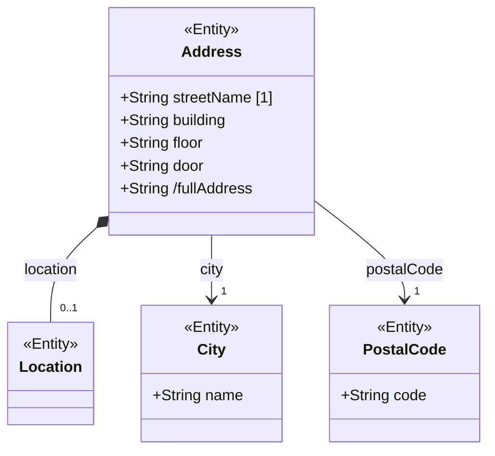

## Model shape

The shape has one address entity, one composed location, and two lookup entities that the address references.

- **Address** holds the street name (required), building, floor and door, plus a derived full-address text. It is not createable, updateable or deleteable through the generated actions; its owner creates it.
- **Location** holds latitude and longitude, both required decimal values. It is composed by the address (0..1), so it belongs to one address and is removed with it.
- **City** holds a name. The address references one city (1..1, association).
- **PostalCode** holds a code. The address references one postal code (1..1, association).

Generated UI: the address form lets the user pick the city and postal code through the association relations. The location is not typed by hand in the reference shape: it is set from a map or a geocoding step, and the view shows the coordinates as read-only values (hide the location fields from the generated edit form, or mark them non-editable in the UI model). The full-address attribute is derived, so it is shown read-only.

## Structure diagram

<!-- mermaid:generated fragment=address-entity-with-location cli=1.1.0.20261108_202643_d9769d90_develop -->

<!-- /mermaid:generated -->
