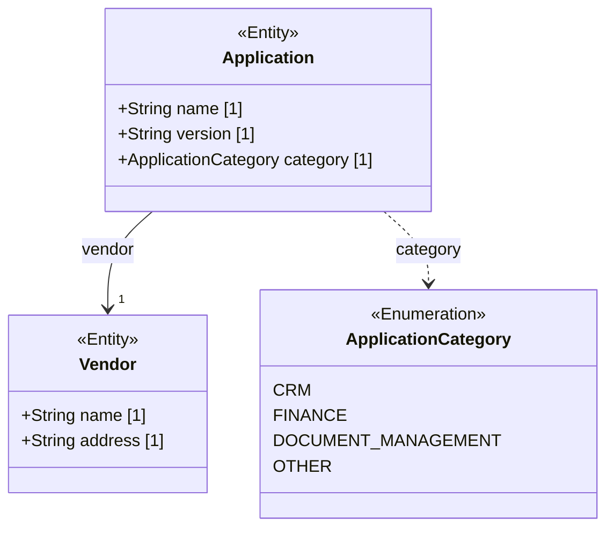

## Model shape

The core shape has two entities and one enumeration.

- **Application** holds a required name (identifier), a required version, and a required category. It is flagged not createable, updateable or deleteable, so the generated actions do not offer those operations; its owners create it. The name is a stored attribute with the identifier flag (natural key).
- **Vendor** holds a required name (identifier) and a required address. It carries the same not-createable, not-updateable, not-deleteable flags.
- **ApplicationCategory** is the enumeration of application types. Each member has a unique integer ordinal (0 to 9999 in JSL models) that stays fixed once data exists.
- Each application has one vendor (1..1, association). Several applications can share one vendor.

Because of those flags the generated pages for Application and Vendor are read-only views and tables for the architecture dashboard. The category is shown as an enumeration value and can be used as a table filter.

## Structure diagram

