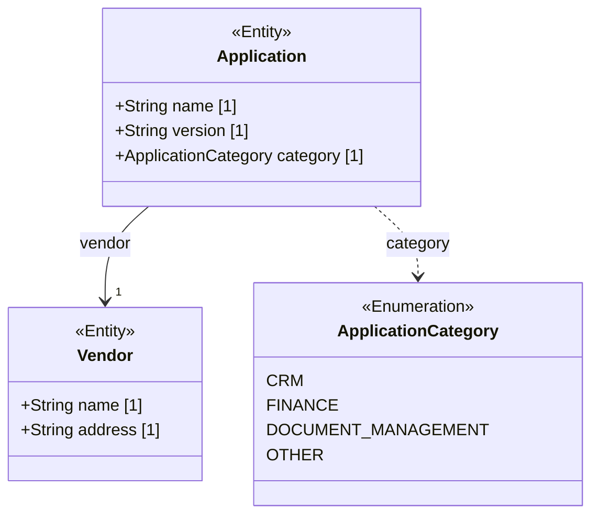

## Model shape

The core shape has two entities and one enumeration.

- **Application** holds a required name (identifier), a required version, and a required category. It is not createable, updateable or deleteable through the generated actions; its owners create it.
- **Vendor** holds a required name (identifier) and a required address. It is not createable, updateable or deleteable through the generated actions.
- **ApplicationCategory** is the enumeration of application types. Values are stored as ordinals.
- Each application has one vendor (1..1, association). Several applications can share one vendor.

The generated pages for Application and Vendor are read-only views and tables for the architecture dashboard. The category filter uses the enumeration values.

## Structure diagram

<!-- mermaid:generated fragment=application-vendor-integration-registry cli=1.1.0.20261108_202643_d9769d90_develop -->

<!-- /mermaid:generated -->
