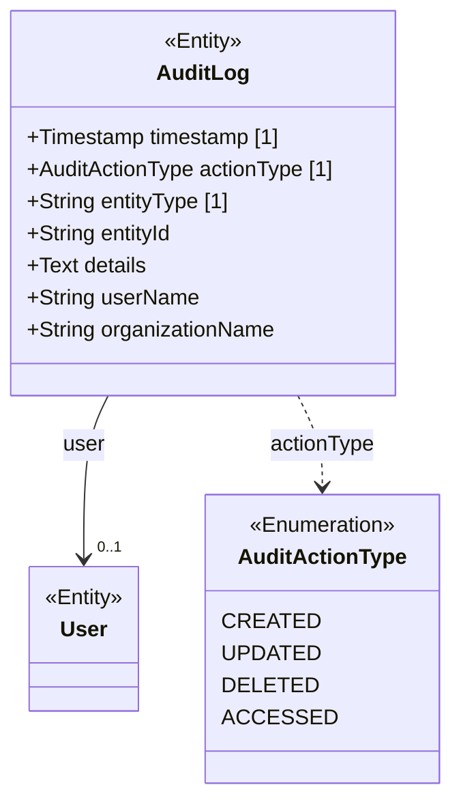

## Model shape

The shape has one non-CRUD entity, one enumeration and one helper entity.

- **AuditLog** is the audit row. It is flagged not createable, updateable or deleteable, so the generated actions do not offer those operations (backend code can still write rows). Its attributes are timestamp (required), actionType (required, enumeration), entityType (required string), entityId (string), details (text), userName (string) and organizationName (string).
- **AuditActionType** is the enumeration of recorded events. Each domain event has one value. Each member has a unique integer ordinal (0 to 9999 in JSL models) that stays fixed once data exists.
- **User** is the target of the optional association. An AuditLog has at most one user (0..1). The relation kind is ASSOCIATION, so deleting the user does not remove the row.

The denormalized userName and organizationName keep a record readable after the user changes. They are written once when the row is created.

Generated UI pages follow from the entity: View and Table pages for AuditLog, and a Form page unless it is removed from the UI model. Hide the Form, because rows are created by the backend. The Table and View pages stay, read-only, for the admin dashboard.

## Structure diagram

