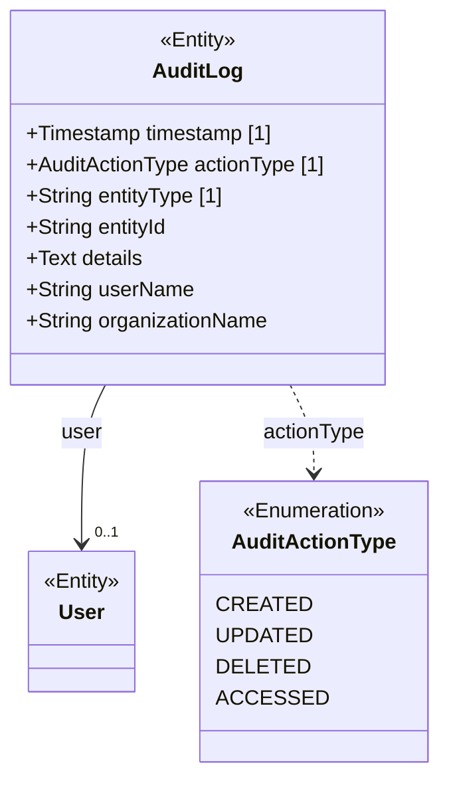

## Model shape

The shape has one non-CRUD entity, one enumeration and one helper entity.

- **AuditLog** is the audit row. It is not createable, updateable or deleteable through generated actions. Its attributes are timestamp (required), actionType (required, enumeration), entityType (required string), entityId (string), details (text), userName (string) and organizationName (string).
- **AuditActionType** is the enumeration of recorded events. Each domain event has one value. Values are stored as ordinals.
- **User** is the target of the optional association. An AuditLog has at most one user (0..1). The relation kind is ASSOCIATION, so deleting the user does not remove the row.

The denormalized userName and organizationName keep a record readable after the user changes. They are written once when the row is created.

Generated UI pages follow from the entity: a View, Form and Table page for AuditLog. The Form should be hidden, because rows are created by the backend. The Table and View pages stay, read-only, for the admin dashboard.

## Structure diagram

<!-- mermaid:generated fragment=audit-log-entity cli=1.1.0.20261108_202643_d9769d90_develop -->

<!-- /mermaid:generated -->
