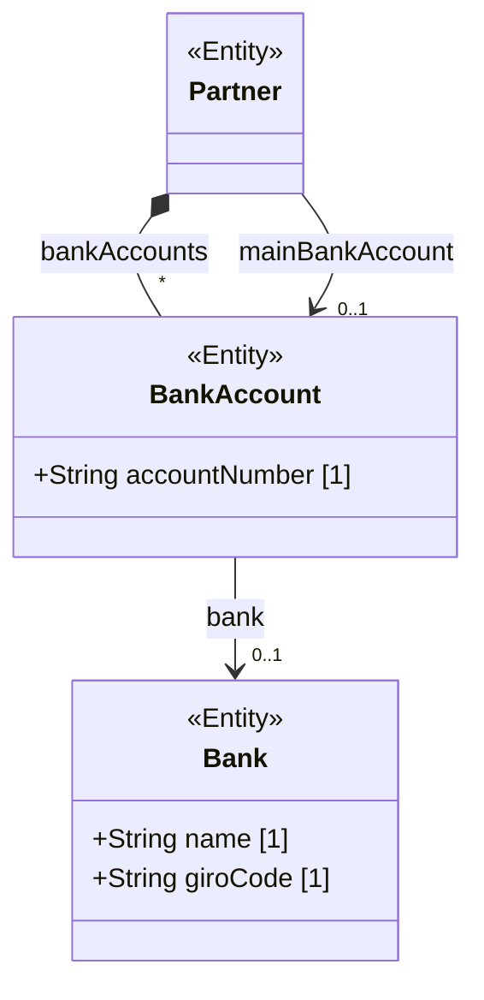

## Model shape

The shape has three entities. BankAccount holds the account number and an optional association to Bank. Bank is the reference entity with a name and a giro code, both identifiers. The owner, shown as Partner, holds its accounts as a composition and designates one as its main account with an optional association.

- **BankAccount** has one required identifier, accountNumber. Its bank is a 0..1 association to Bank, so a bank can be missing and deleting the bank leaves the account in place.
- **Bank** has the identifiers name and giroCode. Both are required.
- **Partner** owns BankAccount through bankAccounts (0..*, composition). Its mainBankAccount (0..1, association) points to one of those accounts. The owner side is one-way: the composition does not have a reverse member.

Other owner types, such as Company, can hold accounts the same way. Each account still has a single owner.

Entities have no UI of their own. Pages appear only for the transfer objects and access points that a project defines over these entities (the platform generates View, Form and Table pages from those). Bank is usually a reference list managed by an administrator, so a project exposes it through a transfer object with a table.

## Structure diagram

<!-- mermaid:generated fragment=bank-account-entity cli=1.1.0.20261108_202643_d9769d90_develop -->

<!-- /mermaid:generated -->
