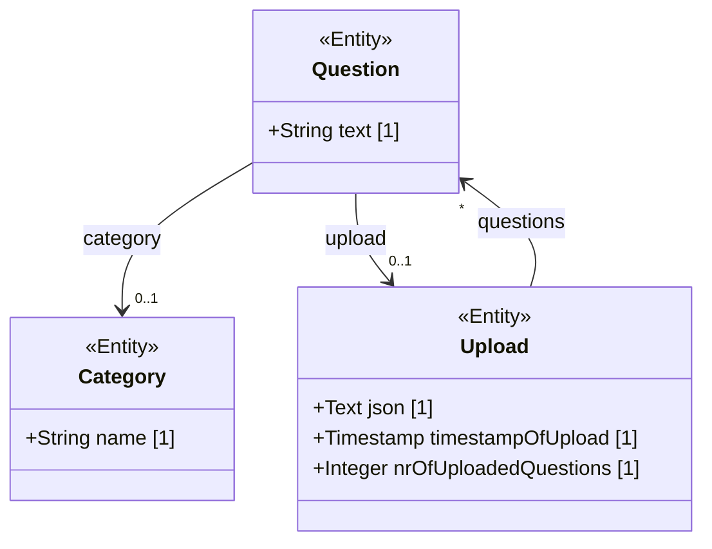

## Model shape

The shape has three entities. Upload records one import batch: the raw JSON text, when it happened, and how many items it created. Upload holds the imported items through a 0..* association to Question. Question has a back-reference to its Upload (0..1) and an optional Category (0..1). Category is a reference entity with a required name.

- **Upload** is non-CRUD: rows are created by the import operation, not by a generated create action. Its attributes are json (required text), timestampOfUpload (required timestamp) and nrOfUploadedQuestions (required integer).
- **Question** has a required text identifier. Its upload back-reference lets a question be traced to the batch that created it.
- **Category** has a required name identifier. Questions reference it through a 0..1 association, so a question can exist without a category.

The import and export operations are static operations on the transfer side, not entity-level members. An unmapped transfer object carries the JSON as its single input, and an operation on the item type reads it. The shape itself only fixes the data that the operations read and write.

Generated UI pages follow from the entities: View, Form and Table pages for Upload, Question and Category. Upload's Form should be hidden, because batches are created by the import operation. Upload's Table and View stay read-only for auditing.

## Structure diagram

<!-- mermaid:generated fragment=bulk-json-upload-entity cli=1.1.0.20261108_202643_d9769d90_develop -->

<!-- /mermaid:generated -->
