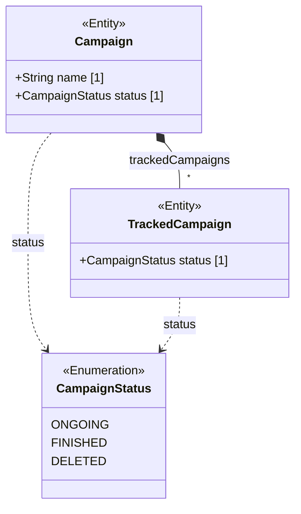

## Model shape

The shape has one enumeration with three members, used as the status attribute of a time-bounded owning entity. Campaign is the owner. Its tracked child entities carry the same status.

- **CampaignStatus** is the enumeration. Its members are ONGOING (ordinal 0), FINISHED (ordinal 1) and DELETED (ordinal 2). Values are stored as ordinals.
- **Campaign** has a required name identifier and a required status that defaults to ONGOING. It owns its TrackedCampaign children through a composition (0..*).
- **TrackedCampaign** has a required status of the same enumeration. It is part of the owner's composition, so it is removed with its owner.

The enumeration has no operations and no relations. The transitions are written in the owner's operations or in project services, not in the model.

Generated UI pages follow from the entities: View, Form and Table pages for Campaign and TrackedCampaign. The status shows as a choice on the Form, so the Form lets a user pick any state. If only the owner's operations may change status, hide the status choice on the Form and expose transitions as actions instead.

## Structure diagram

<!-- mermaid:generated fragment=campaign-lifecycle-status-enum cli=1.1.0.20261108_202643_d9769d90_develop -->

<!-- /mermaid:generated -->
