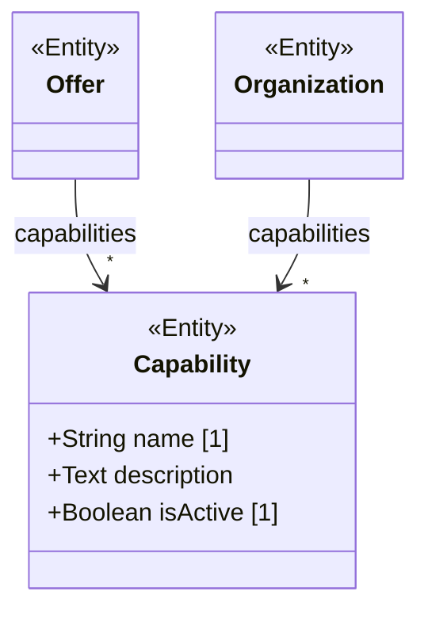

## Model shape

The shape has one lookup entity, Capability, and the entities that tag themselves with it. Capability has a name, an optional description and an isActive flag. Organization and Offer each hold a many-to-many association to Capability.

- **Capability** has a required name identifier, an optional description text, and a required isActive boolean that defaults to true. Turning isActive off hides the capability from new choices without deleting it, so existing tags stay valid.
- **Organization** and **Offer** each hold capabilities (0..*, association). An association does not own the capability, so removing a tag never removes the capability itself.

Other entities can take the same association. Each one adds its own 0..* association to Capability and does not change Capability.

Generated UI pages follow from the entities: View, Form and Table pages for Capability. Organization and Offer get a multi-select of capabilities on their Form. Capability's Form is managed by administrators; the isActive flag is a toggle, not a free-text field.

## Structure diagram

<!-- mermaid:generated fragment=capability-lookup-entity cli=1.1.0.20261108_202643_d9769d90_develop -->

<!-- /mermaid:generated -->
