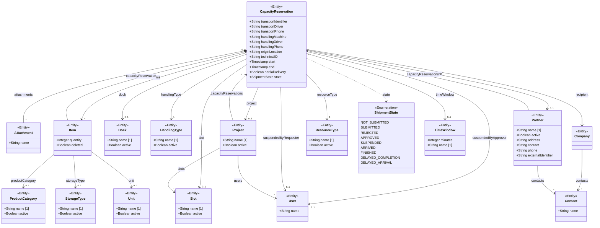

## Model shape

**Reservation entity.** `CapacityReservation` holds the event data: start and end timestamps, a `state` attribute of the `ShipmentState` enumeration (nine members, see [[shipment-state-enum]]), transport details (identifier, driver, phone), handling details (machine, driver, phone, a partial-delivery boolean, origin location) and a technical identifier. Relations:

- `attachments`: 0..* composition to `Attachment`. The attachments live and die with the reservation.
- `items`: 0..* association to `Item`. Each `Item` points back through an optional `capacityReservation` association, so the pair is two independent one-way associations, not one bidirectional relation.
- `dock`, `slot`, `project`, `timeWindow`: optional (0..1) associations to reference entities.
- `partner`: optional association to `Partner`. `recipient`: required association to `Company`.
- `resourceType` and `handlingType`: required (1..1) associations.
- `suspendedByRequester` and `suspendedByApprover`: optional associations to `User`, one for each party that can suspend.

**Line item.** `Item` has an integer `quantity`, a `deleted` boolean used as a soft-delete flag, and optional associations to `ProductCategory`, `Unit` and `StorageType`.

**Reference data.** `Dock`, `Slot`, `ResourceType`, `HandlingType`, `TimeWindow` (adds `minutes`), `ProductCategory`, `Unit` and `StorageType` share a required `name` and a boolean `active`.

**Organizations.** `Partner` (required name, address, contact, phone, external identifier, active; collections of contacts and reservations), `Company` (name, active; contacts) and `Project` (required name, active; collections of users, slots and reservations).

**Access and pages (common practice).** In one project a project links users to slots and reservations, and a user sees only reservations of the projects they are assigned to. The platform offers access filters on the actor side for this; the scoping rule itself is a project convention and is not part of the fragment. Generated View, Form and Table pages for the reservation, its items and attachments are used for the booking actors, and the reference-data pages are kept for administrators.

## Structure diagram

