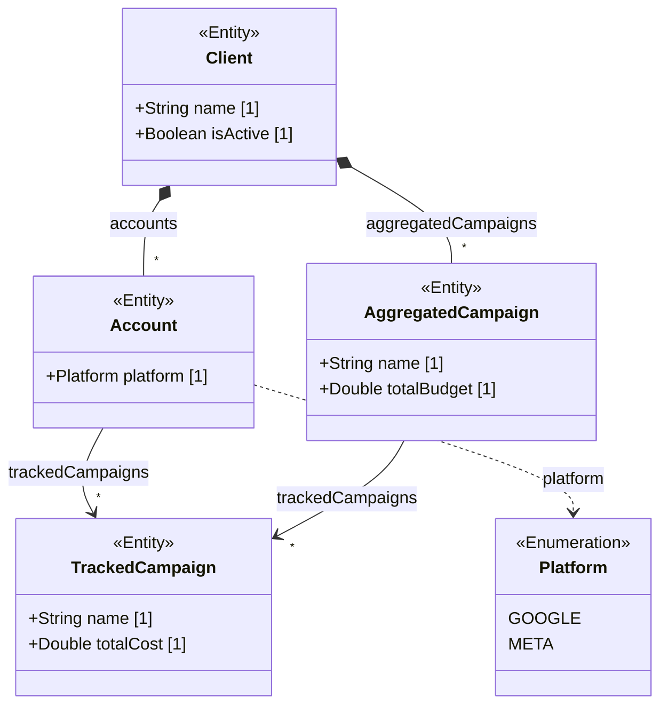

## Model shape

The shape is a small cluster. A Client owns its platform accounts and its budget groups. Each account belongs to one ad platform, given by an enumeration. Tracked campaigns are linked to the account they were found on, and a budget group collects tracked campaigns across accounts.

- **Client** has a required name identifier and a required isActive flag that defaults to true. It owns Account (0..*, composition) and AggregatedCampaign (0..*, composition).
- **Account** has a required platform, an enumeration with one value per supported ad platform (GOOGLE and META in the fragment). It links to TrackedCampaign through a 0..* association, so a campaign can be read from its account without owning it.
- **AggregatedCampaign** has a required name identifier and a required totalBudget. It groups tracked campaigns through a 0..* association, so a campaign can sit in a budget group without being owned by it.
- **TrackedCampaign** has a required name identifier and a required totalCost.

The fragment shows the core of the cluster only. Cost history, fetched-data snapshots, credentials and discovered-but-untracked campaigns are real parts of such a system, but they are left out here. Model them as further owned children where they are needed.

Generated UI pages follow from the entities: View, Form and Table pages for Client, Account and AggregatedCampaign. Account's Form should not expose the platform credential, which belongs to a separate, protected entity.

## Structure diagram

<!-- mermaid:generated fragment=client-account-multi-platform cli=1.1.0.20261108_202643_d9769d90_develop -->

<!-- /mermaid:generated -->
