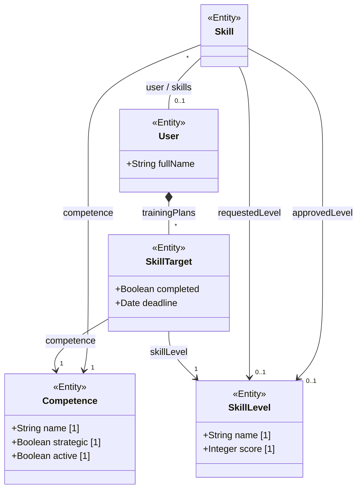

## Model shape

The shape has five entities: the catalog item (Competence), the reference scale (SkillLevel), the junction that holds the two levels (Skill), the training goal (SkillTarget) and the employee (User).

- **Competence** is the item people are assessed on. It is not createable, updateable or deleteable through the people-facing actors. Its attributes are name (required), strategic (required, default false) and active (required, default true).
- **SkillLevel** is reference data with name (required) and score (required, integer). It has no operations.
- **Skill** is the junction. It has no stored attributes. It refers to one Competence (1..1, one-way), one User (0..1, two-way with User.skills), an approved SkillLevel (0..1) and a requested SkillLevel (0..1). Its approve operation (instance) copies the requested level to the approved level.
- **SkillTarget** is a goal with completed and deadline. It refers to one SkillLevel (1..1) and one Competence (1..1), both one-way. A User owns its targets through a composition.
- **User** is the employee, with a full name. It has many skills and a composition of training targets. Its operations are approve-all-skills and create-training-plan.

Skill approval is a separate action on the junction. Display names and scores can be derived attributes computed from these relations on read. The fragment does not include them.

Generated UI pages follow from the entities. Hide the generated create forms for Skill and SkillTarget when a manager or the person creates them through a custom flow. Keep the View and Table pages for the HR dashboard.

## Structure diagram

<!-- mermaid:generated fragment=competence-skill-matrix-cluster cli=1.1.0.20261108_202643_d9769d90_develop -->

<!-- /mermaid:generated -->
