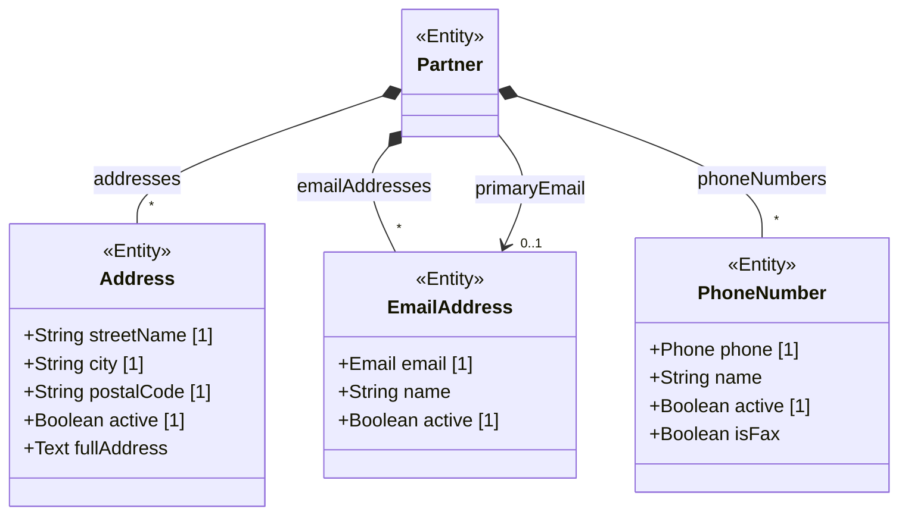

## Model shape

The shape is one parent entity (Partner) with three contact entities composed under it, and one primary association.

- **Partner** is the parent. It has three composition relations, each to zero or more contacts: emailAddresses, phoneNumbers and addresses. It has one optional association, primaryEmail, to an EmailAddress.
- **EmailAddress** has email (required, e-mail type), name (optional), and active (required, default true). Its operations are toggleActive and togglePrimary.
- **PhoneNumber** has phone (required, phone type), name (optional), active (required, default true) and isFax (default false). Its operation is toggleActive.
- **Address** has streetName, city and postalCode (all required), fullAddress (text) and active (required, default true). Its operation is toggleActive.

Contacts are created through the parent, so they are not separate actors. The parent's primary association is the only place that records which contact is preferred.

Generated UI pages follow from the entities: a View, Form and Table page for each contact. The Form for the parent should embed the three contact lists as editable tables, and the primary is chosen from the e-mail table.

## Structure diagram

<!-- mermaid:generated fragment=contact-info-composition-cluster cli=1.1.0.20261108_202643_d9769d90_develop -->

<!-- /mermaid:generated -->
