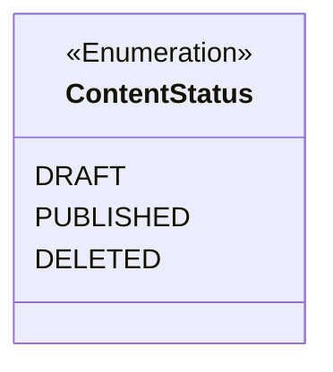

## Model shape

The shape is one enumeration, ContentStatus, with three values in order: DRAFT (ordinal 0), PUBLISHED (ordinal 1) and DELETED (ordinal 2). It has no relations and no operations. A content entity that uses it holds one status attribute typed with this enumeration.

The enumeration is a value type. It adds no table and no UI page of its own. The content entity's generated pages show the status as a read-only value, and the status changes are made by operations on the content entity, not by editing the field.

Some content types add a third kind of value, for example EXPIRED for time-based content or PENDING_REVIEW for moderated content. Those are variations, see the Variations section of the blueprint. They are not part of the core shape.

## Structure diagram

