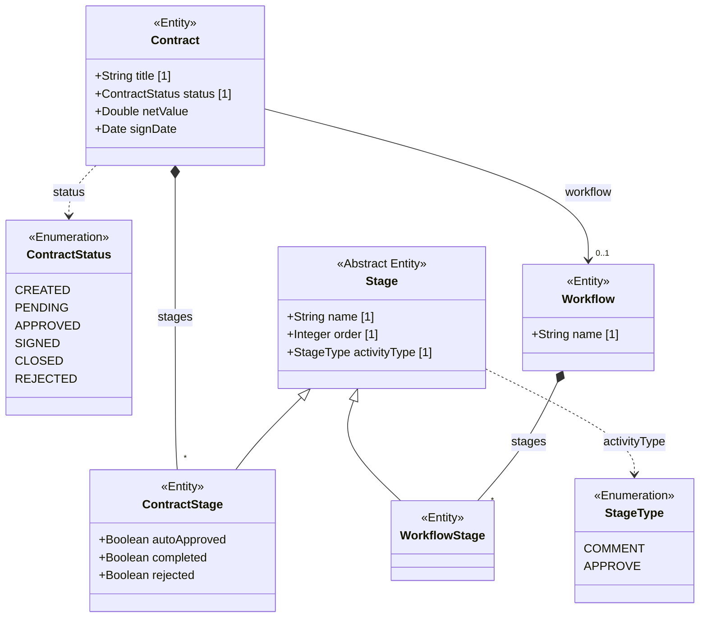

## Model shape

The shape has a Contract with a status and a stage list, a Workflow that owns workflow stage templates, and an abstract Stage with two concrete kinds.

- **Contract** has title (required), status (required, ContractStatus enumeration), netValue and signDate. It owns its runtime stages through a composition (stages, to ContractStage) and refers to at most one Workflow (0..1, association). It has three operations: startApproval, approve and reject.
- **ContractStatus** is an enumeration with six values: CREATED, PENDING, APPROVED, SIGNED, CLOSED and REJECTED.
- **Workflow** has a name (required) and owns its stage templates through a composition (stages, to WorkflowStage).
- **Stage** is the abstract base: name (required), order (required), and activityType (required, StageType enumeration).
- **WorkflowStage** and **ContractStage** extend Stage. WorkflowStage is the template. ContractStage is the runtime copy, with autoApproved, completed and rejected flags.
- **StageType** is an enumeration with two values: COMMENT and APPROVE.

A template is copied into a runtime stage when approval starts, so the template is never changed by a running contract.

Generated UI pages follow from the entities. The Contract's stage list is shown read-only on its view page; the approve and reject actions appear as standard buttons.

## Structure diagram

<!-- mermaid:generated fragment=contract-management-workflow-cluster cli=1.1.0.20261108_202643_d9769d90_develop -->

<!-- /mermaid:generated -->
