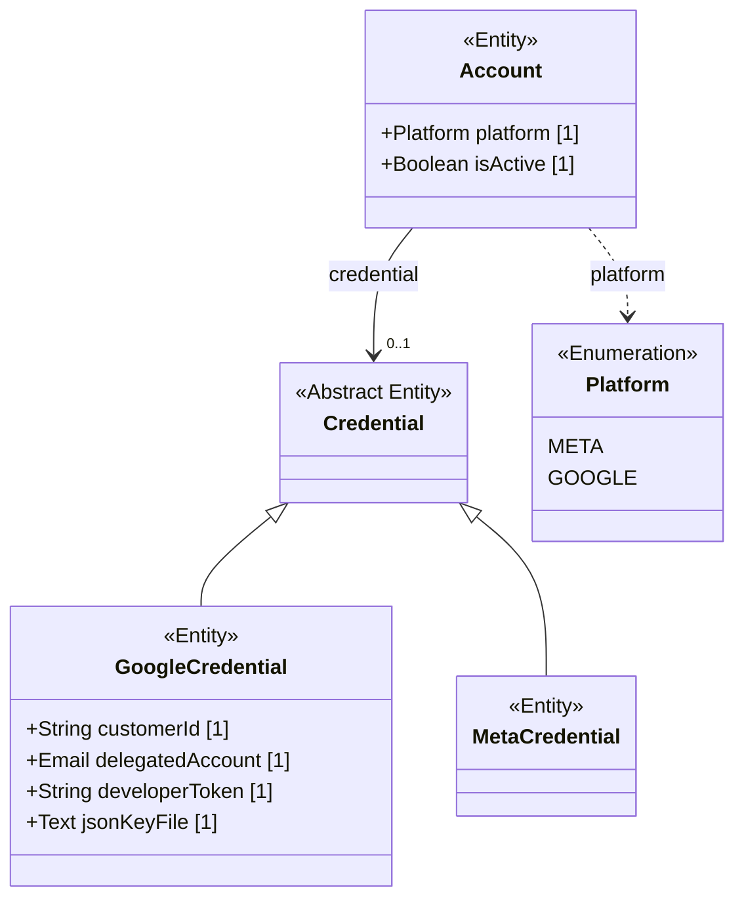

## Model shape

The shape is one abstract base, Credential, with a concrete subtype per platform, and an enumeration that names the platforms.

- **Credential** is the abstract base. It has no attributes of its own and is not createable, updateable or deleteable. An Account refers to one Credential (0..1, association), so the account stays polymorphic.
- **GoogleCredential** extends Credential with customerId (required), delegatedAccount (required, e-mail type), developerToken (required) and jsonKeyFile (required, text).
- **MetaCredential** extends Credential with no attributes yet. It is a placeholder for a second platform.
- **Account** has platform (required, Platform enumeration) and isActive (required, default true). It refers to one Credential (0..1).
- **Platform** is an enumeration with META and GOOGLE. The Account's platform decides which subtype applies.

The base type is used only for lookup through the account. Each subtype is read and written through its own generated pages.

When an access link targets the abstract base, the platform's generated Create action offers the concrete subtypes to choose from (see the [advanced modeling patterns](../../agent-docs/model/advanced-modeling-patterns.md)). Here the Account's credential is set through a custom operation instead.

Generated UI pages follow from the entities. Keep the View and Table pages for each credential subtype, and hide the generated Form for Credential itself, because it is abstract.

## Structure diagram

